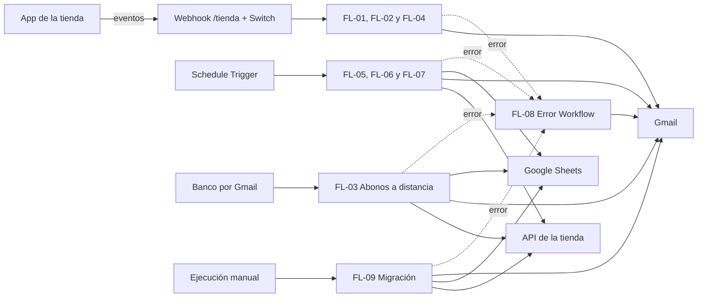
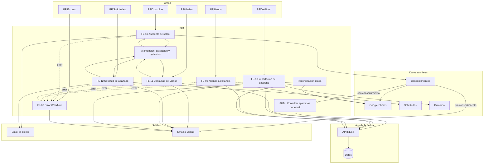
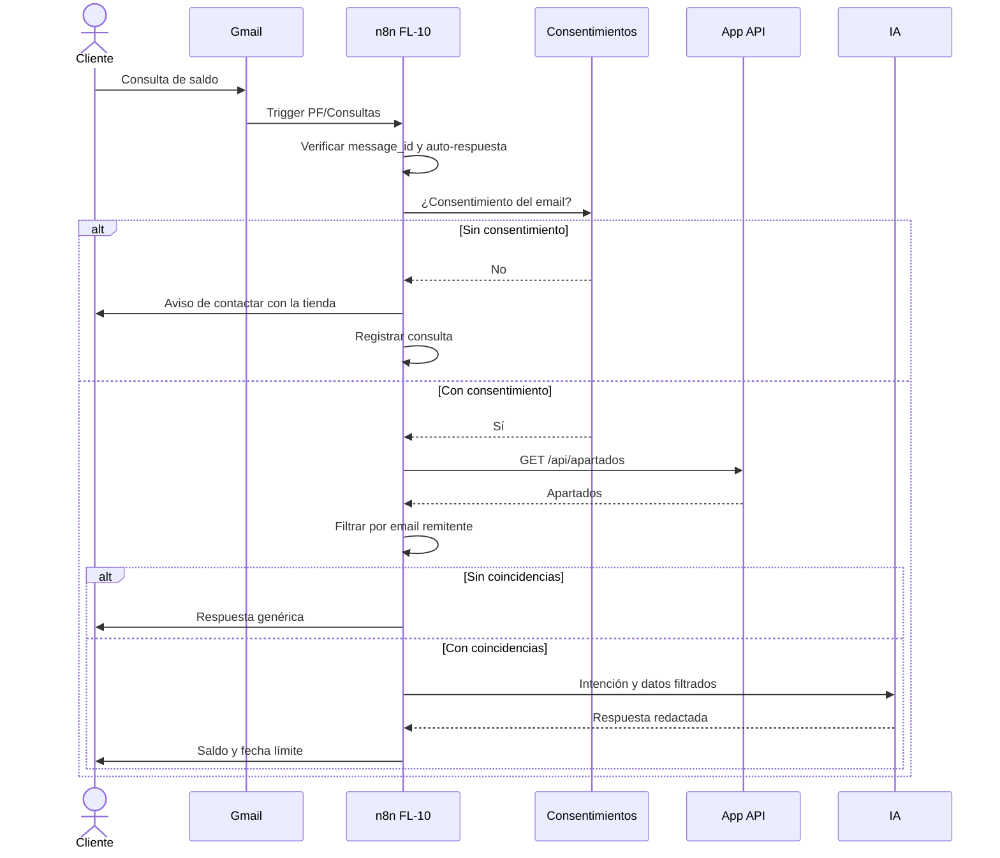
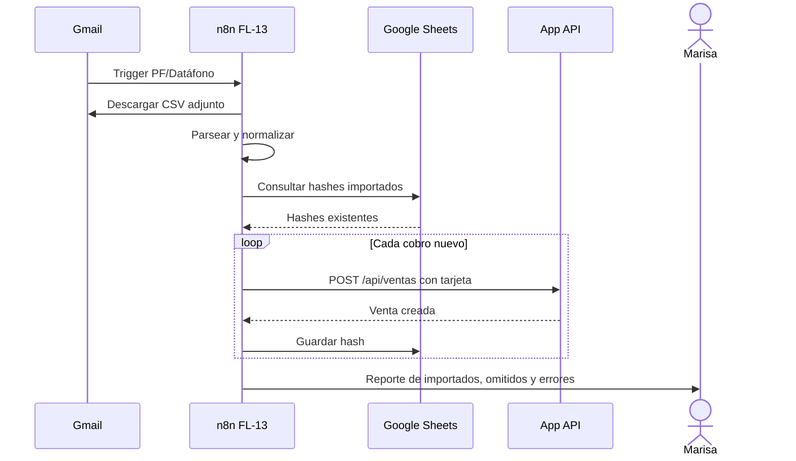
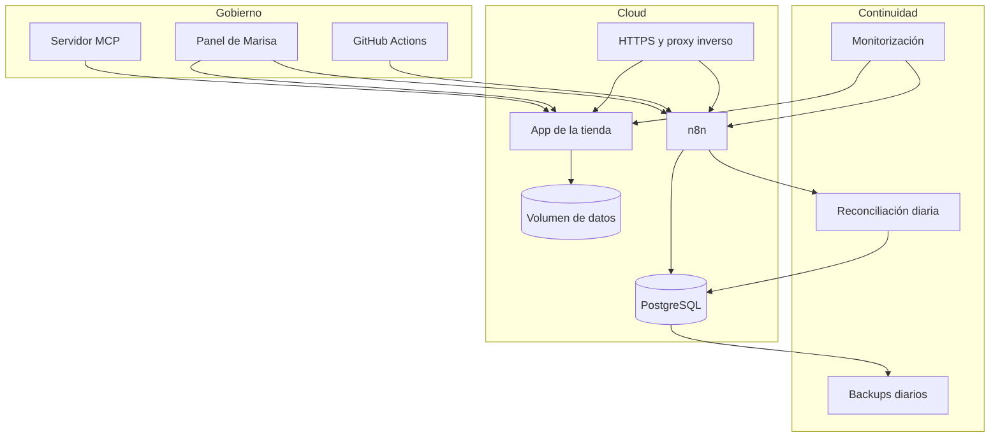
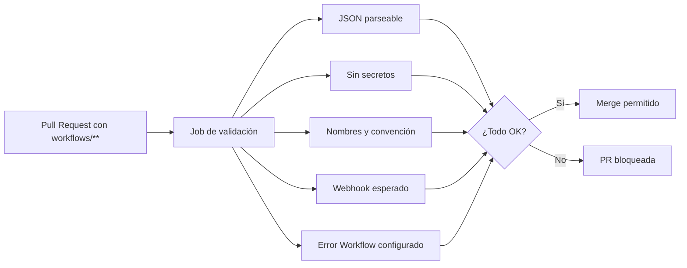
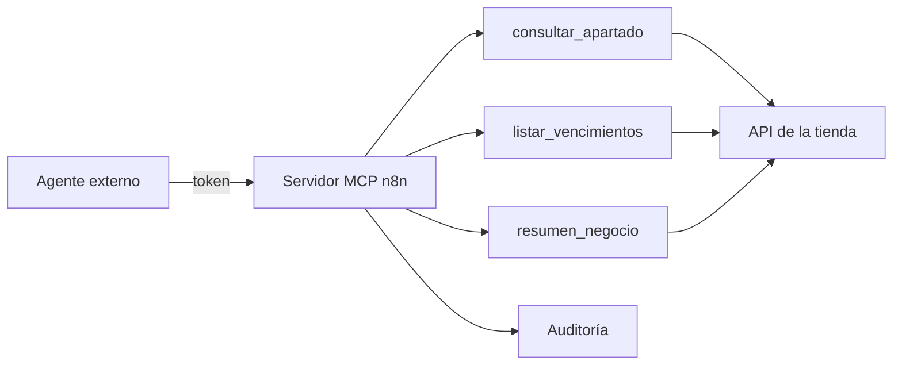

# Automatización n8n · Proyecto completo

**Proyecto:** Automatizaciones n8n · Zapatería Paso Firme  
**Alcance:** Niveles Esencial, Medio, Avanzado y Experto  
**Canal:** Gmail  
**PRD asociado:** [PRD del proyecto completo](../prd-completo.md)  
**Flujo de usuario:** [Flujo de usuario · Proyecto completo](flujo-usuario-completo.md)

Este documento muestra la automatización completa: el núcleo del Nivel Medio, las extensiones de autoservicio y las piezas de operación (PostgreSQL, backups, CI, panel y MCP).

---

## 1. Núcleo Esencial + Medio

Los detalles de nodos, sub-workflows e idempotencia del núcleo están en [Automatización n8n · Nivel Medio](automatizacion-n8n-nivel-medio.md).

---

## 2. Extensiones Avanzado + Experto

---

## 3. Workflows

| ID | Workflow | Disparador | Núcleo | Salidas |
|---|---|---|---|---|
| FL-01 | Confirmación de apartado | Webhook | Webhook + Switch | Gmail |
| FL-02 | Recibo de abono | Webhook | Webhook + Switch | Gmail |
| FL-03 | Abonos a distancia | Gmail Trigger | IA + API | API, Gmail, Sheets |
| FL-04 | Venta grande | Webhook | Webhook + Switch | Gmail |
| FL-05 | Cierre diario | Schedule 21:30 | API + Sheets | Gmail, Sheets |
| FL-06 | Recordatorios y vencimientos | Schedule 08:00 | API + Sheets | Gmail, Sheets |
| FL-07 | Informe mensual | Schedule día 1 | API | Gmail |
| FL-08 | Error Workflow | Error Trigger | — | Gmail |
| FL-09 | Migración del Excel | Manual | CSV + API | API, Sheets, Gmail |
| FL-10 | Asistente de saldo | Gmail Trigger | IA + API + consentimiento | Gmail |
| FL-11 | Consultas de Marisa | Gmail Trigger | IA + API | Gmail |
| FL-12 | Solicitud de apartado | Gmail Trigger | IA + Sheets | Gmail, Sheets |
| FL-13 | Importación del datáfono | Schedule 23:00 + Gmail | CSV + API | API, Sheets, Gmail |
| FL-14 | Panel de Marisa | Consulta | API + Sheets | Panel |
| FL-15 | CI de flujos | Pull Request | GitHub Actions | Check |
| FL-16 | Servidor MCP | Consulta | API | MCP |

---

## 4. Flujo 10 en secuencia

**Claves:**

- La IA no recibe la lista completa de clientes.
- Las cifras salen de la API.
- Sin consentimiento no se responde con datos.
- Una respuesta por `message_id`.

---

## 5. Flujo 13 en secuencia

**Reglas:**

- Solo cobros con tarjeta.
- No se importan devoluciones ni negativos.
- Si no hay CSV, se avisa sin fallar.
- La clave `hash_cobro` evita duplicados.

---

## 6. Infraestructura y operación

### 6.1 Despliegue

| Elemento | Configuración |
|---|---|
| n8n | Contenedor con HTTPS, `WEBHOOK_URL` pública y `N8N_ENCRYPTION_KEY` |
| App | Contenedor con `API_KEY` y `N8N_WEBHOOK_URL` |
| PostgreSQL | Base de datos de n8n |
| Volumen | Datos de la app y de n8n |
| Proxy | TLS, redirección HTTPS y límites de tasa |
| Secretos | Variables del proveedor, nunca en Git |

### 6.2 Backups

- `pg_dump` diario de PostgreSQL.
- Copia de la clave de cifrado de n8n.
- Copia del volumen de la app.
- Retención propuesta: 30 días.
- Restauración de prueba mensual.
- Almacenamiento fuera del servidor principal.

### 6.3 Reconciliación

1. Comparar los abonos del día en la app con `Emails` y los recibos enviados.
2. Reenviar recibos que falten.
3. Registrar eventos no recibidos.
4. Comprobar cierres y avisos.
5. Enviar resumen a Marisa.
6. No duplicar: claves de idempotencia.

### 6.4 Webhook en producción

El webhook no puede quedar abierto. Opciones:

1. **Basic Auth en n8n** y credenciales en la URL de `N8N_WEBHOOK_URL`.
2. **Cabecera de autenticación** enviada por la app, con un cambio mínimo en `backend/services/n8n.py`.
3. **Proxy inverso** que valide una cabecera o un token.

Además:

- Validar el esquema del cuerpo en n8n.
- Rechazar eventos desconocidos.
- Limitar el tamaño del payload.
- Rate limiting en el proxy.
- No exponer el editor de n8n sin autenticación.

---

## 7. CI de flujos

**Comprobaciones mínimas:**

- `JSON.parse` correcto.
- Campos `name`, `nodes`, `connections`, `settings`.
- Nombres únicos y prefijo `PF · FL-0X`.
- Sin `credentials` con valores.
- Sin tokens, claves ni contraseñas.
- Path de webhook `tienda`.
- Error Workflow configurado.
- Tags permitidos.

---

## 8. Panel y MCP

### 8.1 Panel

| Fuente | Datos |
|---|---|
| API de la app | Ventas, abonos, apartados activos, pendiente |
| Google Sheets | Cierres, avisos, solicitudes |
| n8n | Última ejecución y errores |

**Herramienta propuesta:** Looker Studio sobre Google Sheets, o una web sencilla que consuma la API. Requisitos: móvil, autenticación y actualización diaria como mínimo.

### 8.2 MCP

- Solo lectura.
- Token obligatorio.
- Datos mínimos.
- Auditoría de consultas.
- Sin acceso directo a la base de datos.

---

## 9. Datos auxiliares

| Hoja | Clave | Flujos |
|---|---|---|
| `Cierres` | `fecha` | FL-05 |
| `Avisos` | `apartado_id + tipo + fecha_limite` | FL-06 |
| `Emails` | `message_id` | FL-03 |
| `Migracion` | `hash_fila` | FL-09 |
| `Consentimientos` | `email` | FL-10, FL-12 |
| `Solicitudes` | `message_id` | FL-12 |
| `Consultas` | `message_id` | FL-10, FL-11 |
| `Datáfono` | `hash_cobro` | FL-13 |
| `Reconciliacion` | `fecha` | Reconciliación |

---

## 10. Credenciales y variables

| Tipo | Nombre | Uso |
|---|---|---|
| Header Auth | `PF · API tienda` | API |
| OAuth2 | `PF · Gmail` | Correo |
| OAuth2 | `PF · Google Sheets` | Hojas |
| API Key | `PF · IA` | Modelo |
| Postgres | `PF · PostgreSQL` | n8n |
| Variable | `MARISA_EMAIL` | Consultas y avisos |
| Variable | `TIENDA_EMAIL` | Remitente |
| Variable | `VENTA_GRANDE_UMBRAL` | FL-04 |
| Variable | `BANCO_REMITENTES` | FL-03 |
| Variable | `ZONA_HORARIA` | Schedule |
| Variable | `PANEL_URL` | Panel |
| Variable | `MCP_TOKEN` | MCP |

---

## 11. Errores, alertas y límites

| Situación | Tratamiento |
|---|---|
| Error de cualquier workflow | FL-08 envía email a Marisa |
| Gmail con cuota | Reintento y aviso |
| IA con límite | Cola, reintento y fallback |
| API 401 | Error de configuración |
| API 422 | Regla de negocio; aviso |
| Webhook sin autenticación | Rechazo y alerta |
| Backup fallido | Alerta |
| Restauración fallida | Incidencia crítica |
| CI rojo | PR bloqueada |
| MCP sin token | Rechazo y registro |
| Consulta de cliente sin consentimiento | Sin datos y aviso |

---

## 12. Orden de construcción

| Fase | Contenido |
|---|---|
| 1 | Webhook, Switch, sub-workflows y FL-01/FL-02 |
| 2 | FL-03, FL-05 y FL-08 |
| 3 | FL-04, FL-06, FL-07 y FL-09 |
| 4 | FL-10, FL-11, FL-12, FL-13 |
| 5 | Reconciliación, webhook protegido y consentimientos |
| 6 | PostgreSQL, backups, despliegue y monitorización |
| 7 | Panel, CI y MCP |
| 8 | Pruebas, evidencias y documentación |

Cada fase se prueba con datos de ejemplo y se revisa en una PR antes de avanzar.
