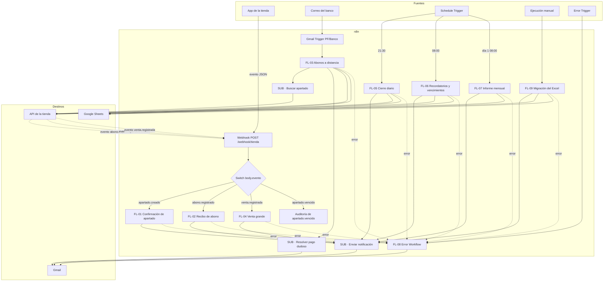
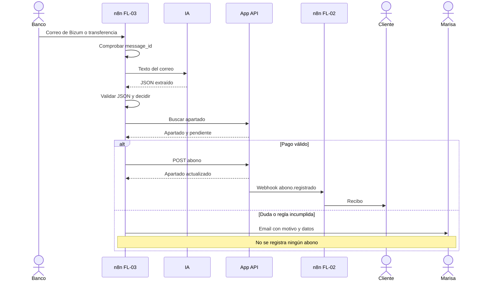

# Automatización n8n · Nivel Medio

**Proyecto:** Automatizaciones n8n · Zapatería Paso Firme  
**Alcance:** Niveles Esencial y Medio (FL-01 a FL-09)  
**Canal:** Gmail  
**PRD asociado:** [PRD Nivel Medio](../prd-nivel-medio.md)  
**Flujo de usuario:** [Flujo de usuario · Nivel Medio](flujo-usuario-nivel-medio.md)

Este documento muestra **cómo se conectan los workflows**: disparadores, webhook, API, Gmail, Google Sheets y errores. No sustituye al PRD; lo hace visible.

---

## 1. Leyenda

| Elemento | Significado |
|---|---|
| Subgrafo “Fuentes” | Lo que inicia un flujo |
| Subgrafo “n8n” | Workflows y sub-workflows |
| Subgrafo “Destinos” | API, Gmail y Google Sheets |
| Flecha continua | Llamada o transición normal |
| Flecha discontinua | Evento, error o dependencia |
| `SUB` | Sub-workflow reutilizable |

---

## 2. Mapa general

> En n8n, el Error Workflow no se dibuja como una flecha de cada nodo: se configura en **Settings → Error Workflow** de cada workflow. El diagrama lo representa para que quede explícito.

---

## 3. Disparadores

| Disparador | Configuración | Workflows |
|---|---|---|
| Webhook | `POST /webhook/tienda`, cuerpo `{evento, datos}` | FL-01, FL-02, FL-04, auditoría |
| Gmail Trigger | Cada minuto, etiqueta `PF/Banco`, filtro de remitentes | FL-03 |
| Schedule Trigger | 21:30, zona `Europe/Madrid` | FL-05 |
| Schedule Trigger | 08:00, zona `Europe/Madrid` | FL-06 |
| Schedule Trigger | Día 1 a las 08:00, zona `Europe/Madrid` | FL-07 |
| Manual | Ejecución desde el editor | FL-09 |
| Error Trigger | Configurado en todos los workflows | FL-08 |

### 3.1 Webhook y Switch

| Orden | Evento | Rama | Acción |
|---|---|---|---|
| 1 | `apartado.creado` | FL-01 | Confirmación al cliente |
| 2 | `abono.registrado` | FL-02 | Recibo o mensaje de recogida |
| 3 | `venta.registrada` | FL-04 | Aviso si supera el umbral |
| 4 | `apartado.vencido` | Auditoría | Solo registrar; FL-06 ya notificó |
| 5 | Desconocido | Log | Sin email |

**Producción:** `http://n8n:5678/webhook/tienda`.  
**Prueba:** `http://n8n:5678/webhook-test/tienda`.  
**Trampa:** si el workflow no está publicado, la app recibe 404 y el aviso se pierde.

---

## 4. Workflows

| Workflow | Nodos clave | API | Gmail | Sheets |
|---|---|---|---|---|
| FL-01 | Switch, Code, IF email, Gmail | Consulta opcional | Confirmación o aviso a Marisa | No |
| FL-02 | Switch, IF estado, Gmail | Consulta opcional | Recibo o recogida | No |
| FL-03 | Gmail Trigger, IA, Code, IF, HTTP, Sheets | Buscar y abonar | Aviso a Marisa en dudas | `Emails` |
| FL-04 | IF umbral, Gmail | No | Aviso a Marisa | No |
| FL-05 | Schedule, HTTP, Code, Sheets, Gmail | Ventas y abonos | Cierre a Marisa | `Cierres` |
| FL-06 | Schedule, HTTP, Code, IF, HTTP, Sheets, Gmail | Activos y vencer | Recordatorio, vale y lista | `Avisos` |
| FL-07 | Schedule, HTTP, Code, Gmail | Ventas, abonos, activos y vales | Informe a Marisa | No |
| FL-08 | Error Trigger, Code, Gmail | No | Error a Marisa | No |
| FL-09 | Read CSV, Code, HTTP, Sheets, Gmail | Crear y abonar | Informe a Marisa | `Migracion` |

### 4.1 Sub-workflows

| Sub-workflow | Entrada | Salida | Usado por |
|---|---|---|---|
| `PF · SUB · Buscar apartado` | Texto, id o nombre | Apartado y coincidencias | FL-03, FL-06, FL-10 |
| `PF · SUB · Enviar notificación` | Plantilla, destinatario, datos | Email enviado o error | FL-01, FL-02, FL-04, FL-05, FL-06, FL-07, FL-09 |
| `PF · SUB · Resolver pago dudoso` | Correo, motivo, datos extraídos | Email a Marisa y registro | FL-03 |

**Convención:** los sub-workflows no tienen disparador propio; se invocan con **Execute Workflow**.

---

## 5. Flujo 3 en secuencia

**Nota:** si el webhook `abono.registrado` se pierde, el abono queda registrado pero el recibo no sale. La reconciliación es una mejora del nivel Avanzado.

---

## 6. Datos auxiliares

| Hoja | Campos mínimos | Workflow |
|---|---|---|
| `Cierres` | `fecha`, totales por forma de pago, `total_dia`, `ejecutado_en` | FL-05 |
| `Avisos` | `clave`, `apartado_id`, `tipo`, `fecha_limite`, `enviado_en` | FL-06 |
| `Emails` | `message_id`, `remitente`, `estado`, `motivo`, `apartado_id`, `importe` | FL-03 |
| `Migracion` | `hash_fila`, `entidad`, `id_api`, `estado`, `motivo` | FL-09 |

**Claves de idempotencia:**

- FL-03: `message_id`.
- FL-05: `fecha`.
- FL-06: `apartado_id + tipo + fecha_limite`.
- FL-09: `hash_fila`.

---

## 7. Credenciales y variables

| Tipo | Nombre | Se usa en |
|---|---|---|
| Header Auth | `PF · API tienda` | Todos los HTTP Request |
| OAuth2 | `PF · Gmail` | Gmail Trigger y nodos Gmail |
| OAuth2 | `PF · Google Sheets` | Lectura y escritura de hojas |
| API Key | `PF · IA` | FL-03 |
| Variable | `MARISA_EMAIL` | Avisos internos |
| Variable | `TIENDA_EMAIL` | Remitente |
| Variable | `VENTA_GRANDE_UMBRAL` | FL-04 |
| Variable | `BANCO_REMITENTES` | FL-03 |
| Variable | `ZONA_HORARIA` | Schedule |

Ningún valor se escribe en el JSON del workflow.

---

## 8. Errores y reintentos

| Situación | Nodo | Tratamiento |
|---|---|---|
| Gmail temporalmente caído | Gmail | Reintento 3 veces; después FL-08 |
| API 401 | HTTP Request | Error de configuración; aviso inmediato |
| API 404 | HTTP Request | Aviso a Marisa |
| API 422 | HTTP Request | `On Error → Continue`; usar `detail` |
| IA con JSON inválido | Code | No registrar; aviso a Marisa |
| Sheets no disponible | Google Sheets | Reintento; después FL-08 |
| Webhook no publicado | Webhook | La app no rompe; revisar logs |
| Duplicado | Code / Sheets | Ignorar y registrar |

### 8.1 Configuración del Error Workflow

1. Crear `PF · FL-08 · Error Workflow`.
2. Configurarlo en **Settings → Error Workflow** de cada workflow.
3. Enviar a Marisa: nombre del workflow, nodo, mensaje, Execution ID y URL.
4. No incluir credenciales ni cuerpos completos.

---

## 9. Orden de construcción recomendado

| Paso | Workflow | Dependencia |
|---|---|---|
| 1 | Webhook + Switch + sub-workflows base | Ninguna |
| 2 | FL-01 | Webhook |
| 3 | FL-02 | Webhook |
| 4 | FL-03 | API, IA, Gmail, `SUB Buscar apartado` |
| 5 | FL-05 | API, Sheets |
| 6 | FL-08 | Todos |
| 7 | FL-04 | Webhook |
| 8 | FL-06 | API, Sheets |
| 9 | FL-07 | API |
| 10 | FL-09 | API, Sheets |

Cada paso termina con el workflow importado, probado y versionado en una PR.

---

## 10. Prueba mínima de humo *(test rápido para verificar que lo esencial funciona)*

1. Crear un apartado con email propio.
2. Comprobar que llega la confirmación.
3. Registrar un abono parcial.
4. Comprobar el recibo.
5. Registrar el abono restante.
6. Comprobar el mensaje de recogida.
7. Enviar los 9 correos de `data/correos/`.
8. Ejecutar el cierre y comprobar el email.
9. Ejecutar FL-06 y comprobar un recordatorio y un vencimiento.
10. Provocar un error y comprobar FL-08.
