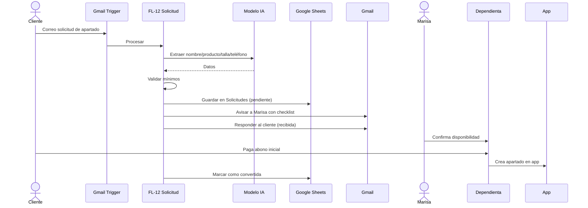

# HU-13 · Solicitud de apartado por Gmail + Importación datáfono (FL-12, FL-13)

**Disparador:** Gmail Trigger sobre `PF/Solicitudes` y `PF/Datáfono` + Schedule  
**Resultado:** Solicitud registrada / Ventas con tarjeta importadas

