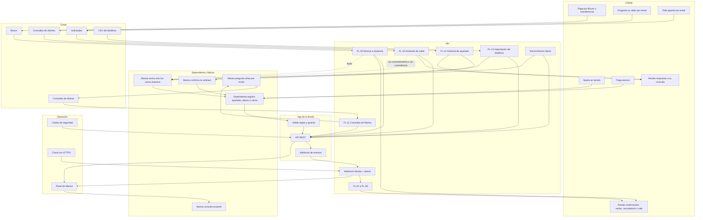
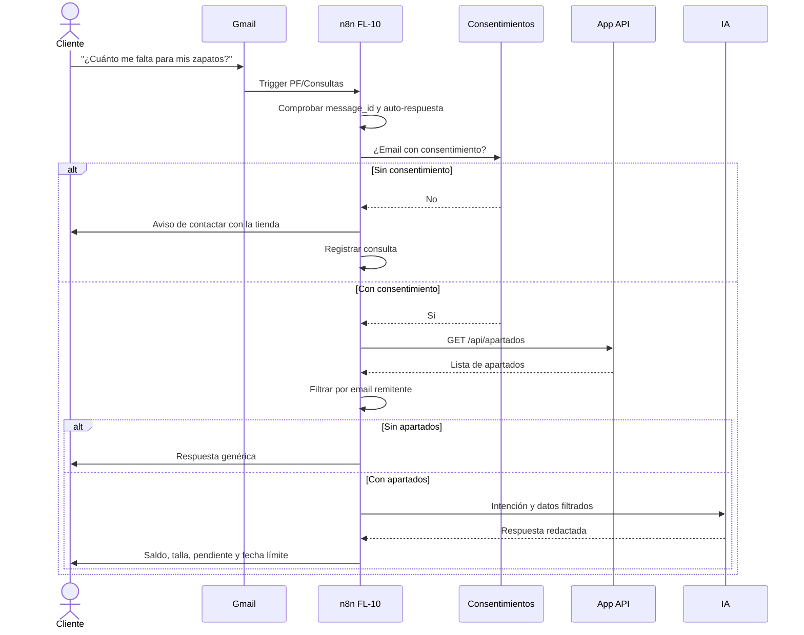
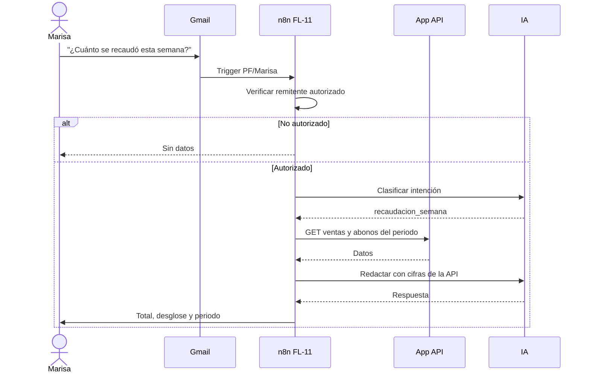
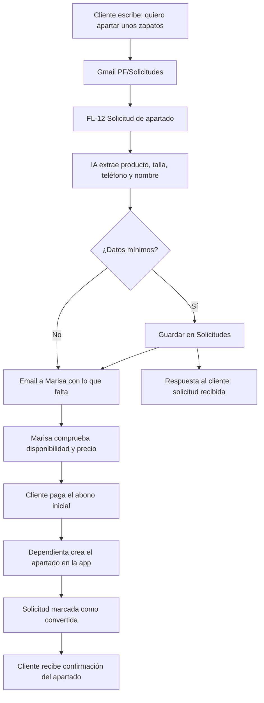
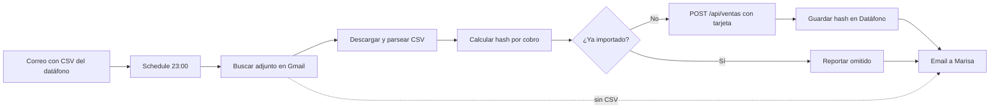
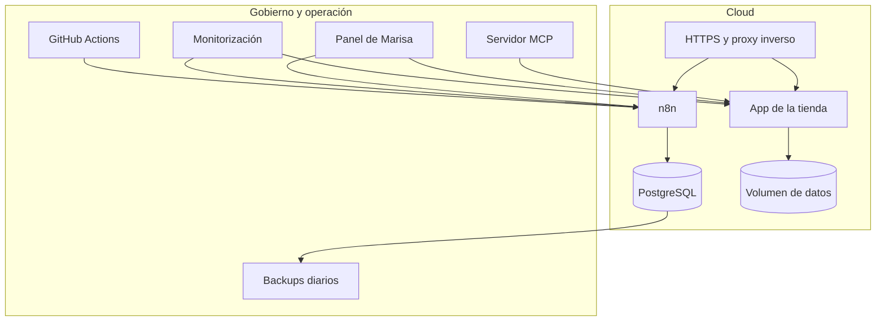

# Flujo de usuario · Proyecto completo

**Proyecto:** Automatizaciones n8n · Zapatería Paso Firme  
**Alcance:** Niveles Esencial, Medio, Avanzado y Experto  
**Canal:** Gmail  
**PRD asociado:** [PRD del proyecto completo](../prd-completo.md)  
**Diagrama de automatización:** [Automatización n8n · Proyecto completo](automatizacion-n8n-completo.md)

Este documento une el recorrido del [Nivel Medio](flujo-usuario-nivel-medio.md) con las funciones avanzadas: consultas por correo, solicitudes de apartado, importación del datáfono, panel de Marisa y operación cloud.

---

## 1. Recorrido completo de un vistazo

---

## 2. Consultas por Gmail

### 2.1 Cliente pregunta por su saldo

**Reglas:**

- Solo se muestran apartados cuyo `email` coincide con el remitente.
- Si hay varios, se listan todos los suyos.
- Las cifras salen de la API; la IA solo redacta.
- Si no hay coincidencia, no se revela nada.
- Se responde una vez por `message_id`.

### 2.2 Marisa pregunta cifras

**Intenciones:** recaudación de hoy, semana o mes; pendiente de cobro; vencimientos; apartados activos; ventas del día.

**Regla:** la IA elige una consulta permitida; no genera consultas arbitrarias ni inventa cifras.

---

## 3. Entradas automáticas

### 3.1 Solicitud de apartado por correo

**Importante:** la solicitud **no crea** el apartado. El apartado se formaliza cuando llega el abono inicial y la dependienta lo registra. Así se evita reservar stock sin pago.

### 3.2 Importación del datáfono

**Reglas:**

- Solo cobros con tarjeta.
- No se importan devoluciones ni importes negativos; se reportan.
- La clave de idempotencia evita duplicados.
- Si no hay CSV, se avisa sin fallar.

---

## 4. Operación y panel

### 4.1 Qué ve Marisa en el panel

| Bloque | Contenido |
|---|---|
| Hoy | Ventas, abonos y total |
| Mes | Recaudación y comparación |
| Pendiente | Suma de lo que falta por cobrar |
| Vencimientos | Apartados que vencen en 7 y 1 días |
| Flujos | Última ejecución y errores |
| Accesos | Enlace a la app y a los cierres |

### 4.2 Continuidad

- n8n con PostgreSQL.
- Copia diaria de base de datos y clave de cifrado.
- Restauración probada una vez al mes.
- Monitorización cada 5 minutos.
- Reconciliación diaria de abonos y eventos.
- Webhook protegido cuando se expone a Internet.

---

## 5. Adaptación de Telegram a Gmail

| Antes | Ahora | Efecto |
|---|---|---|
| Cliente pregunta por Telegram | Cliente escribe a `tienda@pasofirme.example` | Asíncrono; respuesta objetivo en 15 minutos |
| Marisa pregunta por Telegram | Marisa escribe desde su correo autorizado | Copia y trazabilidad en la bandeja |
| Cliente pide apartar por Telegram | Cliente envía correo a `PF/Solicitudes` | La tienda confirma y crea el apartado al cobrar |
| Datáfono se sube a mano | CSV adjunto en Gmail | Importación nocturna |
| Avisos internos por Telegram | Avisos por Gmail | Menos inmediatez, menos credenciales |

**Consecuencia de producto:** Gmail no es un chat. El asistente es útil para consultas no urgentes. Si Marisa necesita inmediatez, se reevalúa un canal adicional en el futuro.

---

## 6. Journey completo *(recorrido del usuario a lo largo de la experiencia)*

| Etapa | Cliente | Dependienta | Marisa | Sistema |
|---|---|---|---|---|
| Descubrimiento | Elige zapatos | Atiende | — | — |
| Alta | Deja abono inicial | Registra apartado | — | App valida y avisa |
| Seguimiento | Paga abonos | Registra | — | Recibos y saldos |
| Pago remoto | Bizum o transferencia | — | Decide dudas | n8n registra o pregunta |
| Vencimiento | Recibe aviso | — | Recibe lista | n8n vence y genera vale |
| Cierre | — | — | Recibe cierre | n8n suma y guarda |
| Informe | — | — | Recibe informe | n8n consulta y envía |
| Consulta | Pregunta por correo | — | — | Asistente responde |
| Solicitud | Pide apartar | Crea al cobrar | Confirma | n8n registra solicitud |
| Operación | — | — | Ve el panel | Cloud, backups y CI |

---

## 7. Momentos de verdad del proyecto completo

1. **El cliente pregunta y recibe sus datos, no los de otro.** La identidad se verifica por email.
2. **Marisa pregunta y recibe cifras reales.** La IA no calcula.
3. **Una solicitud no reserva stock sin pago.** Se confirma con el abono inicial.
4. **El datáfono no duplica ventas.** Hash y reporte.
5. **El webhook público no acepta cualquiera.** Autenticación y validación.
6. **El sistema sobrevive a una caída.** Backups, monitorización y reconciliación.
7. **Un cambio de flujo no rompe main.** CI valida el JSON.
8. **Los datos personales se tratan con cuidado.** Consentimiento, minimización y retención.
