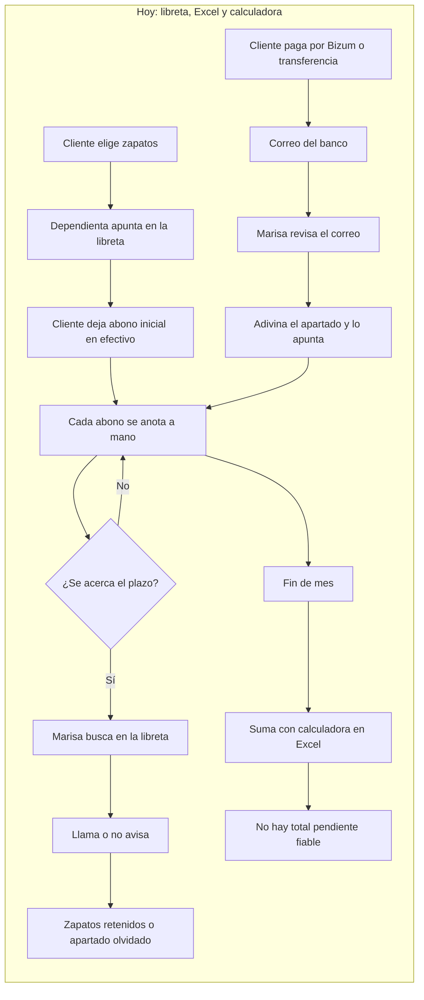
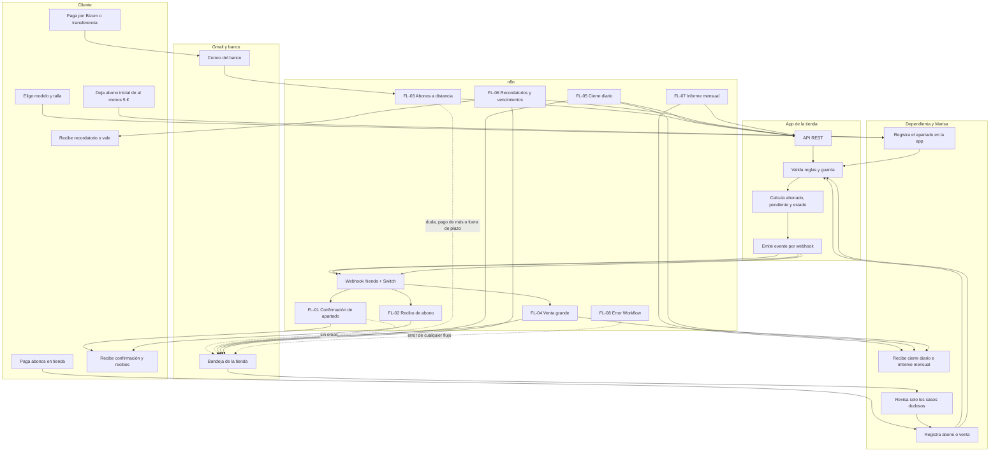
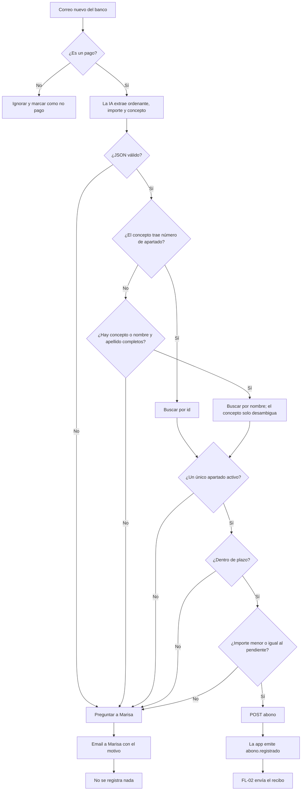

# Flujo de usuario · Nivel Medio

**Proyecto:** Automatizaciones n8n · Zapatería Paso Firme  
**Alcance:** Niveles Esencial y Medio (flujos FL-01 a FL-09)  
**Canal:** Gmail  
**PRD asociado:** [PRD Nivel Medio](../prd-nivel-medio.md)  
**Diagrama de automatización:** [Automatización n8n · Nivel Medio](automatizacion-n8n-nivel-medio.md)

Este documento muestra **qué vive el cliente, la dependienta y Marisa**, primero como se hace hoy y después con la app y n8n. No entra en nodos ni credenciales; eso está en el diagrama de automatización.

---

## 1. Leyenda

| Símbolo | Significado |
|---|---|
| Rectángulo | Acción o pantalla |
| Rombo | Decisión |
| Flecha continua | Flujo normal |
| Flecha discontinua | Aviso, excepción o dependencia |
| “App” | Aplicación de la tienda y su API |
| “n8n” | Automatización |
| “Gmail” | Correo de clientes, tienda o banco |

---

## 2. Cómo se hace hoy

**Puntos de dolor:**

- La libreta y el Excel no hablan entre sí.
- Nadie avisa al cliente antes del vencimiento.
- Los pagos remotos dependen de que Marisa revise el correo.
- El cierre y el informe mensual se hacen a mano.
- No hay una cifra fiable de lo que falta por cobrar.

> **Nota:** los **puntos de dolor** son las fricciones del proceso actual que justifican la automatización. No son soluciones ni requisitos: describen el problema que hay que eliminar o reducir.

---

## 3. Cómo queda automatizado

### Lectura del diagrama

1. La dependienta registra el apartado. La app valida, calcula y emite `apartado.creado`.
2. El webhook reparte el evento. FL-01 envía la confirmación al cliente.
3. Cada abono presencial genera `abono.registrado` y FL-02 envía el recibo.
4. Un Bizum o una transferencia llega a Gmail. FL-03 extrae los datos, busca el apartado y decide si registra o pregunta.
5. Si registra, la app emite `abono.registrado` y FL-02 envía el recibo.
6. Cada noche, FL-05 consulta la API y envía el cierre.
7. Cada mañana, FL-06 avisa de vencimientos y vence los apartados fuera de plazo.
8. El día 1, FL-07 envía el informe mensual.
9. Cualquier fallo va a FL-08, que avisa a Marisa.

> **Importante:** el evento `apartado.vencido` que emite la app no se reenvía al cliente desde el webhook. FL-06 notifica usando la respuesta de la API, para no depender de un aviso que podría perderse.

---

## 4. Pago remoto: la decisión del flujo 3

### Regla de decisión

- **Un solo apartado claro:** se registra, aunque el concepto no coincida con el producto.
- **Nombre abreviado:** solo se registra si el concepto permite desambiguar; si no, se pregunta.
- **Cero coincidencias, varias coincidencias, solo apellido e inicial sin concepto, importe de más, apartado fuera de plazo o no activo:** no se registra y se pregunta.
- **Correo que no es un pago:** se ignora.
- **La IA no decide.** Solo extrae datos; la validación la hace el flujo con la API.

---

## 5. Recorridos por actor

### 5.1 Cliente presencial

| Momento | Qué hace | Qué recibe |
|---|---|---|
| Alta | Elige modelo, talla y deja el abono inicial | Confirmación con precio, abonado, pendiente y fecha límite |
| Abono | Paga en tienda | Recibo con importe y pendiente |
| Liquidación | Completa el precio | Mensaje de que puede recoger sus zapatos |
| Vencimiento | No llega a tiempo | Aviso con el vale y su importe |

### 5.2 Cliente remoto

| Momento | Qué hace | Qué recibe |
|---|---|---|
| Pago | Envía Bizum o transferencia | Recibo si el pago es claro |
| Duda | El pago no identifica el apartado | Marisa le contacta; no se registra nada |
| Pago de más | Intenta pagar más de lo pendiente | Marisa le contacta; no se registra nada |
| Fuera de plazo | Paga un apartado vencido | Marisa le contacta; no se registra nada |

### 5.3 Dependienta

- Sigue usando la misma pantalla para apartados, abonos y ventas.
- No revisa el correo del banco.
- No calcula saldos.
- Solo interviene si Marisa le pide crear o corregir algo.

### 5.4 Marisa

| Situación | Qué recibe |
|---|---|
| Cierre del día | Email con ventas, abonos y total por forma de pago |
| Pago dudoso | Email con el correo original, el motivo y los datos extraídos |
| Venta grande | Email con concepto e importe |
| Vencimiento | Lista de zapatos que vuelven a la venta y vales generados |
| Informe mensual | Recaudación, pendiente, altas, liquidados y vencidos |
| Error | Email con flujo, nodo y error |

---

## 6. Los nueve correos de prueba

| Correo | Lo que ve el cliente | Lo que ve Marisa | Se registra |
|---|---|---|---|
| `01_bizum_carmen` | Recibo de 10 € | Nada | Sí |
| `02_bizum_jorge` | Recibo de 20 € | Nada | Sí, por referencia |
| `03_transferencia_lucia` | Mensaje de recogida | Nada | Sí, queda liquidado |
| `04_bizum_laura` | Nada | Email: paga más de lo pendiente | No |
| `05_bizum_romero` | Nada | Email: no se sabe de quién es | No |
| `06_bizum_paula` | Nada | Email: apartado fuera de plazo | No |
| `07_transferencia_desconocido` | Nada | Email: cliente desconocido | No |
| `08_publicidad_banco` | Nada | Nada | No |
| `09_bizum_silvia` | Recibo de 5 € | Nada | Sí |

---

## 7. Momentos críticos

| Momento | Qué debe pasar | Qué no debe pasar |
|---|---|---|
| Se crea un apartado sin email | Marisa recibe aviso | El flujo falla |
| Un abono deja pendiente 0 | El cliente recibe mensaje de recogida | Se envía un recibo genérico |
| Llega un pago dudoso | Marisa decide | Se registra en el apartado equivocado |
| Se ejecuta dos veces el cierre | Se actualiza la fila del día | Se duplica el cierre |
| Un apartado vence | Se genera vale y se avisa | Se queda activo para siempre |
| Un flujo falla | Marisa se entera en menos de 5 minutos | Falla en silencio |
| Se migra el Excel dos veces | No se duplica nada | Se crean apartados repetidos |

---

## 8. Fuera de este recorrido

- Consultas de saldo por correo.
- Consultas de Marisa por correo.
- Solicitudes de apartado desde casa.
- Importación del datáfono.
- Panel de Marisa.
- Despliegue cloud y copias de seguridad.

Esos recorridos están en [flujo de usuario · proyecto completo](flujo-usuario-completo.md).
