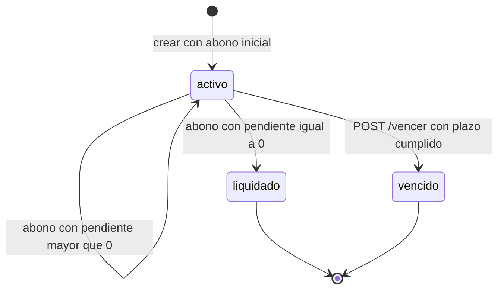
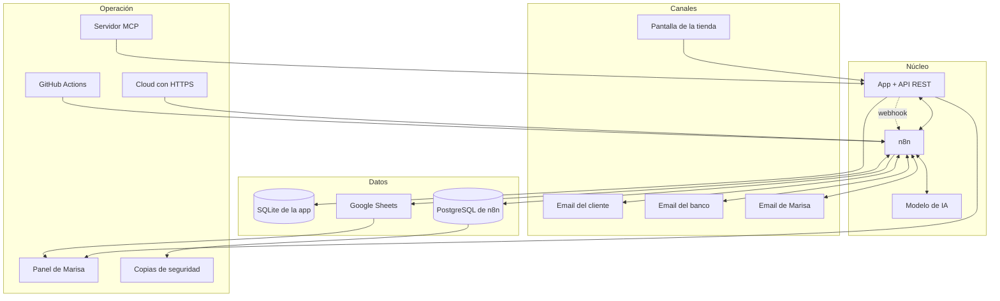

# PRD · Automatizaciones n8n para Zapatería Paso Firme

## Proyecto completo · Esencial, Medio, Avanzado y Experto

| Campo | Valor |
|---|---|
| Proyecto | Automatizaciones con n8n · Zapatería Paso Firme |
| Versión | 1.0 |
| Fecha | Octubre 2026 |
| Estado | Visión completa aprobada para planificación |
| Alcance | Todo el proyecto: flujos 1 a 16 e infraestructura |
| Canal de notificación | Gmail (clientes y tienda) |
| Equipo | Pareja de desarrollo + agente de IA |
| Documentos base | [Briefing](BRIEFING_zapateria.md) · [Guía de la app](guia-de-la-app.md) |
| PRD del nivel ejecutable | [PRD Nivel Medio](prd-nivel-medio.md) |
| Diagramas | [Flujo de usuario](diagramas/flujo-usuario-completo.md) · [Automatización n8n](diagramas/automatizacion-n8n-completo.md) |

---

## 1. Resumen ejecutivo

Zapatería Paso Firme es una tienda de barrio con una dependienta, Marisa como dueña y un servicio de apartados que hoy se sostiene con una libreta, un Excel, una calculadora y la memoria de quien atiende. La app actual ya registra apartados, abonos y ventas, pero no avisa, no cierra la caja, no controla vencimientos, no informa y no concilia los pagos que llegan por Bizum o transferencia.

Este PRD describe el producto completo: desde la automatización esencial del ciclo del apartado hasta un asistente por correo, un panel para Marisa, un despliegue cloud con copias de seguridad y un pipeline de validación de flujos. La app sigue siendo la fuente de verdad; n8n orquesta, decide y comunica.

**Decisión de canal:** todo el producto usa **Gmail**. Las historias del enunciado que proponían Telegram se adaptan a correo electrónico. Esto reduce credenciales y mantiene una sola bandeja, a cambio de perder inmediatez conversacional. Las implicaciones se detallan en la sección 5.4.

**Estrategia de entrega:** construir primero el núcleo (Esencial + Medio), demostrarlo con datos reales y después añadir asistentes, panel y operación cloud. Cada nivel es utilizable por sí mismo.

---

## 2. Problema y oportunidad

### 2.1 Problema

| Dimensión | Situación actual | Impacto |
|---|---|---|
| Operación | Libreta para apartados, Excel para ventas | Dos fuentes de verdad y cuentas que no cuadran |
| Cobro | Bizum y transferencias se revisan a mano | Pagos sin apuntar, abonos mal asignados |
| Relación con el cliente | Nadie avisa del vencimiento ni del recibo | Clientes sorprendidos, zapatos retenidos |
| Gestión | Cierre y recaudación con calculadora | Tiempo perdido y decisiones sin datos |
| Continuidad | Todo depende de que alguien esté delante | Si falla una automatización, nadie se entera |

### 2.2 Oportunidad

- **Liberar tiempo:** eliminar tareas repetitivas de suma, apunte y aviso.
- **Reducir errores:** una sola fuente de verdad y validación por API.
- **Mejorar la experiencia:** el cliente sabe en todo momento cuánto debe y cuándo vence.
- **Dar control:** Marisa ve recaudación, pendiente y vencimientos sin abrir hojas.
- **Profesionalizar la operación:** flujos versionados, errores visibles, copias y despliegue.

### 2.3 Principios de producto

1. **La app manda.** Los importes y estados salen de la API.
2. **La IA extrae, no decide.** Las reglas se aplican con nodos deterministas y API.
3. **Ante la duda, humano.** Un pago dudoso no se registra: se pregunta a Marisa.
4. **Nada se pierde en silencio.** Todo error relevante genera aviso.
5. **Un canal.** Gmail para clientes y tienda; menos fricción y menos credenciales.
6. **Todo versionado.** Flujos JSON en Git, con PR y revisión.

---

## 3. Objetivos

### 3.1 Objetivo general

Convertir la operación manual de la zapatería en un sistema automatizado, trazable y seguro, usando la app como fuente de verdad y n8n como capa de automatización y comunicación.

### 3.2 Objetivos por nivel

| Nivel | Objetivo | Resultado |
|---|---|---|
| Esencial | Automatizar el ciclo básico del apartado y el cobro remoto | Confirmaciones, recibos, abonos y cierre diario |
| Medio | Controlar vencimientos, informar y migrar el histórico | Recordatorios, vales, informe mensual y Excel migrado |
| Avanzado | Dar autoservicio y nuevas entradas | Asistente por Gmail, solicitudes y datáfono |
| Experto | Operar siempre y a escala | Panel, cloud, PostgreSQL, backups, CI y MCP |

### 3.3 Objetivos específicos

| ID | Objetivo | Medición |
|---|---|---|
| OE-01 | Confirmar cada apartado en menos de un minuto | 100 % con email |
| OE-02 | Enviar recibo por cada abono | 100 % de eventos |
| OE-03 | Registrar solos los abonos remotos | 9 de 9 correos de prueba |
| OE-04 | Cerrar la caja cada noche | 100 % de días con actividad |
| OE-05 | Avisar y vencer apartados | 0 duplicados y 0 vencidos sin vale |
| OE-06 | Informar a Marisa | Informe mensual el día 1 antes de las 10:00 |
| OE-07 | Detectar errores | Aviso en menos de 5 minutos |
| OE-08 | Dar autoservicio por correo | 90 % de consultas resueltas sin intervención |
| OE-09 | Operar con continuidad | 99 % de disponibilidad mensual |
| OE-10 | Proteger datos | 0 secretos en Git y consentimiento registrado |

### 3.4 No objetivos

- Sustituir la app por una tienda online.
- Gestionar stock, compras o proveedores.
- Cobrar con pasarela de pago propia.
- Enviar marketing masivo.
- Desarrollar una app móvil nativa.
- Cambiar el modelo de negocio del apartado.

---

## 4. Personas y trabajos por hacer

| Persona | Trabajo por hacer | Dolor | Éxito |
|---|---|---|---|
| **Marisa** | Saber cuánto ha cobrado, cuánto le deben y qué requiere decisión | Calculadora, correos del banco, libreta | Recibe cifras y avisos sin pedirlos |
| **Dependienta** | Atender y registrar sin fricción | Tareas manuales repetidas | La app sigue siendo su única pantalla |
| **Cliente presencial** | Apartar y pagar poco a poco | No sabe cuánto debe ni cuándo vence | Recibe confirmación, recibo y recordatorio |
| **Cliente remoto** | Pagar desde casa | Su pago no se registra o tarda | Pago registrado y recibo automático |
| **Equipo** | Construir y mantener flujos | Falta de contexto y errores silenciosos | Flujos versionados, probados y observables |

> **Nota:** un **punto de dolor** es una fricción concreta del proceso actual que obliga a trabajar a mano, duplicar información o asumir errores. En la tabla, `Dolor` es la fricción principal de cada persona; no es una queja genérica ni una solución.

### 4.1 Historias de usuario

| Nivel | Historias |
|---|---|
| Esencial | HU-01 a HU-05 |
| Medio | HU-06 a HU-10 |
| Avanzado | HU-11 a HU-14 |
| Experto | HU-15 y HU-16 |

La adaptación de las historias de Telegram a Gmail está en la sección 5.4. La trazabilidad completa está en la sección 18.

---

## 5. Alcance

### 5.1 Mapa de flujos

| ID | Flujo | Nivel | Disparador | Resultado |
|---|---|---|---|---|
| FL-01 | Confirmación de apartado | Esencial | `apartado.creado` | Email con resumen |
| FL-02 | Recibo de abono | Esencial | `abono.registrado` | Email con pendiente o recogida |
| FL-03 | Abonos a distancia | Esencial | Gmail Trigger | Abono registrado o consulta |
| FL-04 | Venta grande | Medio | `venta.registrada` | Aviso a Marisa |
| FL-05 | Cierre diario | Esencial | Schedule | Cierre y email |
| FL-06 | Recordatorios y vencimientos | Medio | Schedule | Avisos, vales y lista |
| FL-07 | Informe mensual | Medio | Schedule | Informe a Marisa |
| FL-08 | Error Workflow | Esencial | Error Trigger | Email de error |
| FL-09 | Migración del Excel | Medio | Manual | Histórico cargado |
| FL-10 | Asistente de saldo por Gmail | Avanzado | Gmail Trigger | Respuesta al cliente |
| FL-11 | Consultas de Marisa por Gmail | Avanzado | Gmail Trigger | Respuesta con cifras |
| FL-12 | Solicitud de apartado por Gmail | Avanzado | Gmail Trigger | Solicitud registrada |
| FL-13 | Importación del datáfono | Avanzado | Schedule + Gmail | Ventas con tarjeta |
| FL-14 | Panel de Marisa | Experto | Consulta | Panel actualizado |
| FL-15 | CI de flujos *(Integración Continua: validación automática de flujos en cada cambio)* | Experto | Pull Request | JSON validado |
| FL-16 | Servidor MCP *(Model Context Protocol: servidor que expone datos/acciones a agentes IA)* | Experto | Consulta de agente | Estado de apartados |

### 5.2 Infraestructura incluida

| ID | Elemento | Nivel |
|---|---|---|
| INF-01 | PostgreSQL para n8n | Experto |
| INF-02 | Copias de seguridad automáticas | Experto |
| INF-03 | Despliegue cloud con HTTPS | Experto |
| INF-04 | Monitorización y alertas de disponibilidad | Experto |
| INF-05 | Reconciliación de eventos perdidos | Avanzado |
| INF-06 | Protección del webhook público | Avanzado |
| INF-07 | Registro de consentimientos | Avanzado |

### 5.3 Fuera de alcance

| Elemento | Motivo |
|---|---|
| Telegram, WhatsApp, SMS | Decisión: Gmail como único canal |
| Pasarela de pago o cobro con tarjeta | La tienda usa su datáfono y su banco |
| Gestión de stock e inventario | No forma parte del enunciado |
| Marketing y campañas | El producto es operativo, no publicitario |
| App móvil nativa | La app web y el correo cubren la necesidad |
| Modificación profunda de la app | Se consume tal cual; los cambios mínimos se negocian aparte |

### 5.4 Adaptación de Telegram a Gmail

| HU original | Propuesta con Gmail | Ventaja | Limitación |
|---|---|---|---|
| HU-11 · Saldo por Telegram | Cliente escribe a `tienda@pasofirme.example` desde su email; n8n identifica el remitente, consulta la API y responde en el hilo | Sin nueva credencial; historial en el correo | No es tiempo real; depende de que el cliente use su email |
| HU-12 · Marisa pregunta | Marisa envía un correo desde su dirección autorizada; n8n responde con cifras de la API | Trazabilidad y copia en la bandeja | Menos inmediato que un chat |
| HU-13 · Entrada automática | Solicitud de apartado por email; el datáfono se importa desde un CSV adjunto en Gmail | Un solo canal y un solo flujo de entrada | La solicitud no crea el apartado hasta que llega el abono inicial |
| HU-14 · Datos personales | Webhook autenticado, consentimiento en Google Sheets y minimización de datos | Control centralizado | Requiere proceso manual para registrar consentimiento |

**Tradeoff aceptado:** Gmail no sustituye a un chat. El asistente será asíncrono y con un objetivo de respuesta de 15 minutos en horario de tienda, no de segundos. Si en el futuro se quiere inmediatez, se reevalúa Telegram como canal adicional.

---

## 6. Reglas de negocio

### 6.1 Reglas del apartado

| Regla | Detalle |
|---|---|
| Abono inicial | Mínimo 5 € y no más que el precio |
| Plazo | 90 días desde la fecha del apartado |
| Abonos | Cualquier importe, nunca más que el pendiente |
| Liquidación | `pendiente = 0` → estado `liquidado` |
| Vencimiento | `hoy > fecha_limite` → puede vencerse por API |
| Vale | Lo abonado se convierte en vale; no se devuelve efectivo |
| Un apartado = un par | Un producto y una talla |
| Formas de pago | `efectivo`, `tarjeta`, `bizum` |



### 6.2 Cálculos

| Métrica | Fórmula | Fuente |
|---|---|---|
| Abonado | Suma de abonos | API |
| Pendiente | `precio - abonado` | API |
| Ventas del día | Ventas directas + abonos del día | API |
| Recaudación mensual | Ventas + abonos del mes | API |
| Pendiente total | Suma de `pendiente` de apartados activos | API |

### 6.3 Reglas avanzadas

| Regla | Detalle |
|---|---|
| Identidad del cliente | Solo se muestran apartados cuyo `email` coincide con el remitente |
| Identidad de Marisa | Solo responde a `MARISA_EMAIL`; el resto se ignora o se deriva a la tienda |
| Solicitud de apartado | No crea el apartado; genera una solicitud y avisa a la tienda |
| Confirmación de solicitud | Se crea el apartado cuando llega el abono inicial |
| Datáfono | Se importan solo cobros con tarjeta; se evitan duplicados por fecha, concepto e importe |
| Consentimiento | Recordatorios y asistente requieren consentimiento; confirmaciones y recibos son transaccionales |
| Datos a la IA | Solo el texto del mensaje; nunca listados completos ni datos de otros clientes |

### 6.4 Transferencias

La app solo admite `efectivo`, `tarjeta` y `bizum`. Las transferencias se registran como `bizum` y se identifica el origen real en el aviso a Marisa y en la hoja de auditoría. Es un supuesto a confirmar.

---

## 7. Experiencia de usuario

### 7.1 Recorrido completo

El detalle visual está en [flujo de usuario · proyecto completo](diagramas/flujo-usuario-completo.md). Incluye el proceso actual, el núcleo automatizado y las funciones avanzadas.

### 7.2 Journeys *(Recorridos: secuencia de acciones que sigue un usuario para lograr un objetivo)*

| Journey | Actor | Momentos clave |
|---|---|---|
| Apartar en tienda | Cliente + dependienta | Alta, abono inicial, confirmación, abonos, liquidación, recogida |
| Pagar desde casa | Cliente + Marisa | Bizum o transferencia, lectura del banco, abono, recibo |
| Cerrar el día | Marisa | Consulta de movimientos, cierre, email |
| No perder el plazo | Cliente + Marisa | Recordatorio a 7 y 1 días, vencimiento, vale |
| Saber cómo va el mes | Marisa | Informe mensual, pendiente, decisiones |
| Preguntar saldo | Cliente | Correo, identificación, respuesta con sus apartados |
| Preguntar cifras | Marisa | Correo autorizado, consulta, respuesta |
| Pedir un apartado | Cliente | Correo, solicitud, aviso a tienda, abono inicial |
| Importar datáfono | Dependienta + Marisa | CSV adjunto, importación, informe |
| Ver el negocio | Marisa | Panel con ventas, recaudación, pendiente y vencimientos |

### 7.3 Momentos de verdad

1. **El cliente paga y no sabe si su pago se registró.** El recibo debe llegar sin intervención.
2. **El pago es dudoso.** Marisa debe recibir un correo claro con los datos y la pregunta.
3. **El apartado vence.** El cliente debe recibir su vale y Marisa la lista de zapatos.
4. **Algo falla.** Marisa debe enterarse antes que el cliente.
5. **Marisa pregunta por sus cifras.** La respuesta debe salir de la API, no del modelo.

---

## 8. Arquitectura

### 8.1 Vista de alto nivel



### 8.2 Componentes

| Componente | Responsabilidad | Nivel |
|---|---|---|
| App de la tienda | Datos, reglas, API y webhook | Base |
| n8n | Orquestación y notificaciones | Base |
| Gmail | Entrada y salida de mensajes | Base |
| Google Sheets | Cierres, avisos, correos, consentimientos y migración | Medio/Avanzado |
| Modelo de IA | Extracción e interpretación controlada | Esencial/Avanzado |
| PostgreSQL | Persistencia de n8n | Experto |
| Panel | Visualización para Marisa | Experto |
| GitHub Actions | Validación de flujos | Experto |
| MCP Server | Consulta por agentes | Experto |

### 8.3 Integración app ↔ n8n

| Dirección | Mecanismo | Cuándo |
|---|---|---|
| App → n8n | Webhook `POST /webhook/tienda` | Al crear apartado, abonar, vender o vencer |
| n8n → app | API REST con `X-API-Key` | Al consultar, registrar o vencer |

**Eventos:**

| Evento | Datos | Rama |
|---|---|---|
| `apartado.creado` | Apartado | FL-01 |
| `abono.registrado` | Apartado + `importe` | FL-02 |
| `venta.registrada` | Venta | FL-04 |
| `apartado.vencido` | Apartado + vale | Auditoría; FL-06 ya notifica |

**Regla operativa:** el webhook es *best effort*. Si n8n está caído o el flujo no está publicado, el aviso se pierde. Los flujos programados consultan la API. En el nivel Avanzado se añade una reconciliación diaria de eventos y abonos.

### 8.4 Endpoints

| Endpoint | Uso |
|---|---|
| `GET /api/apartados` | Listar, filtrar y buscar |
| `GET /api/apartados/resumen` | Conteo por estado |
| `GET /api/apartados/{id}` | Detalle con abonos y vale |
| `POST /api/apartados` | Crear apartado |
| `POST /api/apartados/{id}/abonos` | Registrar abono |
| `POST /api/apartados/{id}/vencer` | Vencer y generar vale |
| `GET /api/abonos` | Abonos entre fechas |
| `GET /api/ventas` | Ventas entre fechas |
| `POST /api/ventas` | Registrar venta |
| `GET /api/vales` | Vales generados |
| `GET /api/excel` | Exportación |

### 8.5 Etiquetas y filtros de Gmail

| Etiqueta | Uso | Flujo |
|---|---|---|
| `PF/Banco` | Avisos de Bizum y transferencia | FL-03 |
| `PF/Consultas` | Consultas de clientes | FL-10 |
| `PF/Marisa` | Consultas de Marisa | FL-11 |
| `PF/Solicitudes` | Peticiones de apartado | FL-12 |
| `PF/Datáfono` | CSV de cobros con tarjeta | FL-13 |
| `PF/Errores` | Copia de errores | FL-08 |

Filtros de remitente del banco en `BANCO_REMITENTES`. No se procesan correos de dominios no esperados.

### 8.6 Credenciales y variables

| Tipo | Nombre | Uso |
|---|---|---|
| Header Auth | `PF · API tienda` | `X-API-Key` |
| OAuth2 | `PF · Gmail` | Leer y enviar |
| OAuth2 | `PF · Google Sheets` | Datos auxiliares |
| API Key | `PF · IA` | Extracción e interpretación |
| Postgres | `PF · PostgreSQL` | n8n |
| Variable | `MARISA_EMAIL` | Consultas y avisos |
| Variable | `TIENDA_EMAIL` | Remitente |
| Variable | `VENTA_GRANDE_UMBRAL` | Aviso de venta |
| Variable | `BANCO_REMITENTES` | Filtro |
| Variable | `ZONA_HORARIA` | `Europe/Madrid` |
| Variable | `PANEL_URL` | Panel |
| Variable | `MCP_TOKEN` | Servidor MCP |

### 8.7 Almacenamiento auxiliar

| Hoja | Clave | Uso |
|---|---|---|
| `Cierres` | `fecha` | Cierre diario |
| `Avisos` | `apartado_id + tipo + fecha_limite` | Idempotencia *(repetir sin duplicar efectos)* de recordatorios |
| `Emails` | `message_id` | Idempotencia *(repetir sin duplicar efectos)* de correos |
| `Migracion` | `hash_fila` | Idempotencia *(repetir sin duplicar efectos)* de migración |
| `Consentimientos` | `email` | RGPD *(Reglamento General de Protección de Datos)* |
| `Solicitudes` | `message_id` | Solicitudes de apartado |
| `Consultas` | `message_id` | Consultas respondidas |
| `Datáfono` | `hash_cobro` | Deduplicación de ventas |
| `Reconciliacion` | `fecha` | Eventos perdidos |

### 8.8 Convenciones

| Elemento | Convención |
|---|---|
| Workflow | `PF · FL-0X · Nombre` |
| Sub-workflow | `PF · SUB · Nombre` |
| Nodo | `FL0X · Nombre` |
| JSON | `workflows/fl-0x-nombre.json` |
| Tag | `paso-firme`, `nivel-*`, `fl-0x` |
| Error | `PF · FL-08 · Error Workflow` |

---

## 9. Requisitos funcionales

### 9.1 Núcleo (Esencial + Medio)

Estos flujos se detallan paso a paso en el [PRD Nivel Medio](prd-nivel-medio.md). Aquí se fija el contrato de producto.

| Flujo | Disparador | Salida | Criterios clave |
|---|---|---|---|
| FL-01 | `apartado.creado` | Email de confirmación | Modelo, talla, precio, abonado, pendiente y fecha límite; sin email, aviso a Marisa |
| FL-02 | `abono.registrado` | Recibo | Importe pagado y pendiente; mensaje de recogida si `liquidado` |
| FL-03 | Gmail Trigger | Abono o consulta | 9 correos resueltos; duda = no registrar y preguntar |
| FL-04 | `venta.registrada` | Aviso a Marisa | `importe > VENTA_GRANDE_UMBRAL` |
| FL-05 | Schedule 21:30 | Cierre diario | Ventas + abonos por forma de pago; sin movimientos no falla |
| FL-06 | Schedule 08:00 | Avisos y vales | 7 y 1 días; vence fuera de plazo; una vez por aviso |
| FL-07 | Schedule día 1 | Informe mensual | Recaudación, pendiente, nuevos, liquidados y vencidos |
| FL-08 | Error Trigger | Email de error | Flujo, nodo, error y enlace; sin secretos |
| FL-09 | Manual | Migración | Fechas originales; sin duplicados; informe de dudosos |

**Reglas transversales del núcleo:**

- Un único webhook con Switch por `body.evento`.
- Todos los HTTP Request con Header Auth.
- Importes desde la API, nunca recalculados.
- Errores 4xx tratados con rama de aviso; 5xx con reintento.
- Idempotencia *(repetir sin duplicar efectos)* en FL-03, FL-05, FL-06 y FL-09.
- En FL-03, si el ordenante solo tiene apellido e inicial y no hay concepto, no se empareja aunque haya un único candidato.

### 9.2 FL-10 · Asistente de saldo por Gmail

**Objetivo:** que un cliente pregunte por correo cuánto le falta y reciba una respuesta con sus datos reales.

**Disparador:** Gmail Trigger sobre `PF/Consultas`, cada minuto.

**Pasos:**

1. Ignorar auto-respuestas, correos masivos y remitentes desconocidos.
2. Comprobar `message_id` en `Consultas`.
3. Clasificar la intención con IA: `saldo`, `plazo`, `recogida`, `otro`.
4. Obtener los apartados del remitente:
   - `GET /api/apartados` sin paginación;
   - filtrar por `email` igual al remitente, sin distinguir mayúsculas.
5. Si no hay coincidencia, responder con un mensaje genérico y ofrecer contacto con la tienda.
6. Si hay uno o varios, construir una tabla con producto, talla, abonado, pendiente, fecha límite y estado.
7. Redactar la respuesta con IA **a partir del JSON de la API**; no permitir que invente cifras.
8. Responder en el mismo hilo y registrar la consulta.

| ID | Requisito |
|---|---|
| RF-50 | Identificar al cliente por el email remitente. |
| RF-51 | Mostrar solo los apartados de ese email. |
| RF-52 | Responder con saldo y fecha límite de la API. |
| RF-53 | No revelar la existencia de otros clientes ni sus datos. |
| RF-54 | Si no hay coincidencia, responder sin datos y ofrecer la tienda. |
| RF-55 | Responder una sola vez por `message_id`. |
| RF-56 | La IA no recibe el listado completo de clientes. |

**Criterios de aceptación:**

- [ ] Un cliente con un apartado recibe su saldo correcto.
- [ ] Un cliente con varios apartados los ve todos, solo los suyos.
- [ ] Un remitente desconocido no ve ningún dato.
- [ ] La respuesta cita la fecha límite de la API.
- [ ] Repetir el correo no genera dos respuestas.

### 9.3 FL-11 · Consultas de Marisa por Gmail

**Objetivo:** que Marisa pregunte por correo y reciba cifras del negocio.

**Disparador:** Gmail Trigger sobre `PF/Marisa`.

**Intenciones soportadas:**

| Intención | Consulta | Respuesta |
|---|---|---|
| Recaudación de hoy | Ventas + abonos de hoy | Total y desglose |
| Recaudación de la semana | Rango semanal | Total y desglose |
| Recaudación del mes | Rango mensual | Total y desglose |
| Pendiente de cobro | Apartados activos | Suma de pendientes |
| Vencimientos | Apartados activos por fecha límite | Lista con días restantes |
| Apartados activos | `GET /api/apartados?estado=activo` | Lista resumida |
| Ventas de hoy | `GET /api/ventas` | Lista y total |

| ID | Requisito |
|---|---|
| RF-57 | Solo responder a `MARISA_EMAIL`. |
| RF-58 | Mapear la pregunta a una consulta permitida; no generar consultas arbitrarias. |
| RF-59 | Responder con cifras de la API y fecha de corte. |
| RF-60 | Si no entiende la pregunta, pedir aclaración. |
| RF-61 | Registrar la consulta y la respuesta. |

**Criterios de aceptación:**

- [ ] Una pregunta de recaudación devuelve el total correcto.
- [ ] Una pregunta de pendiente devuelve la suma de activos.
- [ ] Un remitente no autorizado no obtiene datos.
- [ ] La respuesta indica el periodo consultado.
- [ ] Una pregunta ambigua no inventa una cifra.

### 9.4 FL-12 · Solicitud de apartado por Gmail

**Objetivo:** que un cliente pida apartar desde casa y la tienda reciba la solicitud sin crear un apartado prematuro.

**Disparador:** Gmail Trigger sobre `PF/Solicitudes`.

**Pasos:**

1. Extraer con IA: nombre, producto, talla, teléfono y texto libre.
2. Usar el email remitente como email del cliente.
3. Validar campos mínimos.
4. Guardar en `Solicitudes` con `message_id` y estado `pendiente`.
5. Enviar a Marisa un correo con la solicitud y una lista de comprobación: disponibilidad, talla, precio y abono inicial.
6. Responder al cliente: solicitud recibida, la tienda confirmará y el apartado se formaliza con el abono inicial.
7. Cuando llega el abono inicial, la dependienta crea el apartado en la app y marca la solicitud como `convertida`.

| ID | Requisito |
|---|---|
| RF-62 | No crear el apartado automáticamente. |
| RF-63 | Extraer y validar los datos de la solicitud. |
| RF-64 | Avisar a Marisa con todos los datos. |
| RF-65 | Responder al cliente con los siguientes pasos. |
| RF-66 | Evitar solicitudes duplicadas por `message_id`. |
| RF-67 | Permitir marcar la solicitud como convertida o descartada. |

**Criterios de aceptación:**

- [ ] Una solicitud válida llega a Marisa y no crea un apartado.
- [ ] El cliente recibe confirmación de recepción.
- [ ] Una solicitud incompleta se reporta a Marisa.
- [ ] La solicitud se marca como convertida al crear el apartado.

### 9.5 FL-13 · Importación del datáfono

**Objetivo:** cargar cada noche los cobros con tarjeta sin duplicar ventas.

**Disparador:** Schedule diario a las 23:00 + búsqueda en Gmail del CSV adjunto en `PF/Datáfono`.

**Pasos:**

1. Buscar el CSV del día.
2. Descargar y parsear el archivo.
3. Normalizar fecha, concepto, importe y forma de pago.
4. Calcular un hash por cobro.
5. Descartar los ya importados en `Datáfono`.
6. `POST /api/ventas` con `forma_pago: "tarjeta"`.
7. Reportar a Marisa: importados, duplicados y errores.
8. Si no hay CSV, avisar sin fallar.

| ID | Requisito |
|---|---|
| RF-68 | Importar solo cobros con tarjeta. |
| RF-69 | No duplicar cobros ya registrados. |
| RF-70 | Reportar importados, duplicados y rechazados. |
| RF-71 | No importar devoluciones o importes negativos; reportarlos. |
| RF-72 | Gestionar la ausencia de CSV sin romper el flujo. |

**Criterios de aceptación:**

- [ ] Un CSV válido crea las ventas con tarjeta.
- [ ] Ejecutar dos veces el mismo CSV no duplica.
- [ ] Un cobro duplicado se reporta como omitido.
- [ ] Un CSV ausente genera aviso, no error.

### 9.6 FL-14 · Panel de Marisa

**Objetivo:** ver en una pantalla el estado del negocio sin abrir hojas ni correos.

**Contenido:**

- Ventas y recaudación de hoy, semana y mes.
- Pendiente total de cobro.
- Apartados activos y próximos vencimientos.
- Últimos cierres.
- Estado de los flujos (última ejecución y errores).

| ID | Requisito |
|---|---|
| RF-73 | Mostrar datos actualizados al menos una vez al día. |
| RF-74 | Ser legible en móvil. |
| RF-75 | Restringir el acceso a Marisa y personas autorizadas. |
| RF-76 | Enlazar con la app para el detalle. |

**Criterios de aceptación:**

- [ ] El panel muestra las cuatro cifras clave.
- [ ] Los datos coinciden con la app.
- [ ] Se ve correctamente en móvil.
- [ ] No es accesible sin autenticación.

### 9.7 FL-15 · CI de flujos *(Integración Continua: validación automática en PR)*

**Objetivo:** impedir que un JSON inválido o con secretos llegue a main.

**Pasos en GitHub Actions:**

1. Detectar cambios en `workflows/**`.
2. Validar que cada archivo es JSON parseable.
3. Comprobar campos mínimos de un workflow de n8n.
4. Comprobar nombres únicos y convención `PF · FL-0X`.
5. Buscar patrones de secretos, tokens y claves.
6. Comprobar que el webhook apunta al path esperado.
7. Fallar el PR si algo no cumple.

| ID | Requisito |
|---|---|
| RF-77 | Ejecutar la validación en cada PR que toque workflows. |
| RF-78 | Rechazar JSON inválido, nombres duplicados o secretos. |
| RF-79 | Publicar un resumen legible del fallo. |

**Criterios de aceptación:**

- [ ] Un JSON roto hace fallar el PR.
- [ ] Un secreto embebido hace fallar el PR.
- [ ] Un workflow válido pasa.
- [ ] El check es obligatorio antes de mergear.

### 9.8 FL-16 · Servidor MCP *(Model Context Protocol: expone datos a agentes IA)*

**Objetivo:** que otros agentes consulten el estado de los apartados sin acceso directo a la base de datos.

**Herramientas propuestas:**

| Herramienta | Entrada | Salida |
|---|---|---|
| `consultar_apartado` | `id` o `email` | Apartado sin datos sensibles innecesarios |
| `listar_vencimientos` | `dias` | Apartados que vencen en el rango |
| `resumen_negocio` | `desde`, `hasta` | Ventas, abonos y pendiente |

| ID | Requisito |
|---|---|
| RF-80 | Exponer solo lectura. |
| RF-81 | Exigir token o autenticación. |
| RF-82 | Auditar cada consulta. |
| RF-83 | No devolver más datos de los necesarios. |

### 9.9 Infraestructura

| ID | Requisito |
|---|---|
| INF-01 | n8n usa PostgreSQL en Docker Compose. |
| INF-02 | Copia diaria de PostgreSQL y de la clave de cifrado de n8n. |
| INF-03 | Despliegue cloud con HTTPS y variables de entorno. |
| INF-04 | Monitorización de disponibilidad y alertas. |
| INF-05 | Reconciliación diaria de abonos y eventos perdidos. |
| INF-06 | Webhook protegido con autenticación cuando se expone a Internet. |
| INF-07 | Registro de consentimientos y política de retención. |

---

## 10. Requisitos no funcionales

| ID | Categoría | Requisito |
|---|---|---|
| RNF-01 | Seguridad | `X-API-Key` en toda llamada; webhook autenticado en producción. |
| RNF-02 | Secretos | Cero credenciales en nodos, JSON o Git. |
| RNF-03 | Privacidad | Minimización de datos enviados a IA; solo el mensaje necesario. |
| RNF-04 | RGPD *(Reglamento General de Protección de Datos)* | Consentimiento registrado; datos usados solo para la operación. |
| RNF-05 | Idempotencia *(repetir sin duplicar efectos)* | Todos los flujos reejecutables sin duplicar efectos. |
| RNF-06 | Reintentos | 3 intentos con espera creciente para 5xx y timeouts. |
| RNF-07 | Errores de negocio | 4xx esperados con rama de aviso, sin reintento. |
| RNF-08 | Observabilidad | Ejecuciones, logs y alertas en menos de 5 minutos. |
| RNF-09 | Rendimiento | Confirmación y recibo en menos de 1 minuto; assistant en menos de 15 minutos. |
| RNF-10 | Disponibilidad | 99 % mensual; los flujos programados no dependen del webhook. |
| RNF-11 | Recuperación | Restauración de backup probada al menos una vez al mes. |
| RNF-12 | Mantenibilidad | Un workflow por flujo, sub-workflows y convención de nombres. |
| RNF-13 | Portabilidad | Docker Compose y variables de entorno. |
| RNF-14 | Coste | Capas gratuitas y modelos gratuitos; revisar límites. |
| RNF-15 | Integridad | Importes en EUR con dos decimales; la app calcula. |
| RNF-16 | Accesibilidad | Emails legibles en móvil, con texto plano y HTML. |
| RNF-17 | Trazabilidad | Cada flujo tiene spec, PR, pruebas y evidencia. |

---

## 11. Datos y modelo

### 11.1 Entidades

| Entidad | Campos | Origen |
|---|---|---|
| Cliente | `cliente`, `telefono`, `email` | App |
| Apartado | `id`, `fecha`, `producto`, `talla`, `precio`, `abonado`, `pendiente`, `fecha_limite`, `estado` | App |
| Abono | `id`, `apartado_id`, `fecha`, `importe`, `forma_pago` | App |
| Venta | `id`, `fecha`, `concepto`, `importe`, `forma_pago` | App |
| Vale | `id`, `codigo`, `apartado_id`, `fecha`, `importe`, `usado` | App |
| CierreDiario | `fecha`, totales por tipo y forma de pago | Sheets |
| Aviso | `clave`, `apartado_id`, `tipo`, `enviado_en` | Sheets |
| CorreoProcesado | `message_id`, `tipo`, `estado`, `motivo` | Sheets |
| Consentimiento | `email`, `consentimiento`, `fecha`, `origen` | Sheets |
| Solicitud | `message_id`, `cliente`, `producto`, `talla`, `estado` | Sheets |
| Consulta | `message_id`, `remitente`, `intencion`, `respondido_en` | Sheets |
| CobroDatáfono | `hash`, `fecha`, `concepto`, `importe` | Sheets |
| Reconciliacion | `fecha`, `eventos_perdidos`, `abonos_revisados` | Sheets |

### 11.2 Eventos

Se mantienen los cuatro eventos de la app. Los flujos leen `body.evento` y `body.datos`.

```json
{"evento": "apartado.creado", "datos": {"id": 25, "cliente": "Carmen Ruiz", "email": "carmen@example.com", "producto": "Botín piel marrón", "talla": "38", "precio": 89.9, "abonado": 10.0, "pendiente": 79.9, "fecha_limite": "2027-01-18", "estado": "activo"}}
```

```json
{"evento": "abono.registrado", "datos": {"id": 25, "cliente": "Carmen Ruiz", "email": "carmen@example.com", "producto": "Botín piel marrón", "precio": 89.9, "abonado": 30.0, "pendiente": 59.9, "fecha_limite": "2027-01-18", "estado": "activo", "importe": 20.0}}
```

```json
{"evento": "venta.registrada", "datos": {"id": 257, "fecha": "2026-10-20", "concepto": "Crema calzado", "importe": 4.5, "forma_pago": "efectivo"}}
```

```json
{"evento": "apartado.vencido", "datos": {"apartado": {"id": 16, "estado": "vencido"}, "vale": {"codigo": "VALE-00016", "importe": 5.0}}}
```

### 11.3 Idempotencia *(repetir sin duplicar efectos)*

| Flujo | Clave | Almacén |
|---|---|---|
| FL-03 | `message_id` | `Emails` |
| FL-05 | `fecha` | `Cierres` |
| FL-06 | `apartado_id + tipo + fecha_limite` | `Avisos` |
| FL-09 | `hash_fila` | `Migracion` |
| FL-10 | `message_id` | `Consultas` |
| FL-11 | `message_id` | `Consultas` |
| FL-12 | `message_id` | `Solicitudes` |
| FL-13 | `hash_cobro` | `Datáfono` |

### 11.4 Reconciliación

Objetivo: detectar abonos o eventos que se perdieron porque n8n estaba caído.

1. Cada noche, comparar los abonos del día en la app con los mensajes procesados y los recibos enviados.
2. Si un abono no tiene recibo, reenviarlo.
3. Si un evento no llegó, registrar la incidencia.
4. Enviar a Marisa un resumen de reconciliación.
5. No duplicar nada: usar las claves de idempotencia.

---

## 12. Seguridad, privacidad y RGPD *(Reglamento General de Protección de Datos)*

### 12.1 Seguridad

- API con `X-API-Key`; clave en credencial de n8n.
- Webhook protegido en producción con Basic Auth o cabecera; la app debe poder enviar la credencial.
- HTTPS obligatorio en cloud.
- Credenciales OAuth2 de Gmail y Sheets con permisos mínimos.
- Sin secretos en JSON, capturas, logs ni repositorio.
- Acceso al panel restringido.
- Token para MCP.
- Revisión de PRs con foco en seguridad.

### 12.2 Privacidad

| Dato | Uso | Destino |
|---|---|---|
| Nombre | Identificar al cliente | App, email, IA solo si está en el mensaje |
| Email | Enviar mensajes e identificar consultas | App, Gmail |
| Teléfono | Contacto alternativo | App; no se envía a IA |
| Producto, talla, precio | Gestión del apartado | App, email |
| Importes | Recibos e informes | App, email, Sheets |
| Texto del correo del banco | Extraer pago | IA, con minimización |
| Consultas | Responder | Gmail, Sheets |

### 12.3 RGPD *(Reglamento General de Protección de Datos)*

- **Base legal:** ejecución de un contrato para la gestión del apartado; consentimiento para recordatorios y asistente.
- **Minimización:** a la IA solo se envía el texto del correo que se procesa.
- **Consentimiento:** hoja `Consentimientos`; sin consentimiento no se envían recordatorios ni respuestas de asistente.
- **Derechos:** el cliente puede pedir acceso, rectificación o supresión; Marisa lo gestiona y se documenta.
- **Retención:** datos de la app mientras exista relación comercial; hojas auxiliares con retención definida (propuesta: 12 meses).
- **Transferencias internacionales:** revisar el proveedor del modelo de IA y su política; preferir proveedores con garantías.
- **Registro de actividades:** documento breve con canales, datos y finalidades.

### 12.4 Datos que no salen

- Listados completos de clientes.
- Teléfonos y direcciones.
- Datos de otros clientes.
- Credenciales.
- Contenido completo de correos ajenos al pago.

---

## 13. Observabilidad y operación

| Elemento | Herramienta | Frecuencia |
|---|---|---|
| Ejecuciones de n8n | Historial de n8n | Continua |
| Errores | FL-08 | Inmediata |
| Disponibilidad | UptimeRobot o similar | Cada 5 minutos |
| Backups | `pg_dump` + volumen | Diaria |
| Restauración | Prueba controlada | Mensual |
| Reconciliación | FL de reconciliación | Diaria |
| Panel de flujos | FL-14 | Continua |
| Coste de IA | Revisión de cuotas | Semanal |

**SLO propuestos:**

- Confirmaciones y recibos: 99 % en menos de 1 minuto.
- Cierre diario: disponible antes de las 22:00.
- Informe mensual: antes de las 10:00 del día 1.
- Asistente: 90 % en menos de 15 minutos en horario de tienda.
- Errores: aviso en menos de 5 minutos.

---

## 14. Criterios de aceptación y pruebas

### 14.1 Núcleo

Se aceptan los criterios del [PRD Nivel Medio](prd-nivel-medio.md), incluidas las pruebas T-01 a T-20.

### 14.2 Avanzado

| ID | Prueba | Resultado esperado |
|---|---|---|
| T-21 | Cliente con un apartado pregunta saldo | Respuesta con su saldo y fecha límite |
| T-22 | Cliente con varios apartados pregunta | Lista completa, solo los suyos |
| T-23 | Remitente desconocido pregunta | Sin datos; ofrece la tienda |
| T-24 | Marisa pregunta recaudación | Cifra correcta y periodo |
| T-25 | Remitente no autorizado pregunta a Marisa | Sin datos |
| T-26 | Solicitud de apartado válida | Solicitud registrada; no se crea apartado |
| T-27 | Solicitud incompleta | Aviso a Marisa |
| T-28 | CSV de datáfono válido | Ventas con tarjeta creadas |
| T-29 | CSV repetido | Sin duplicados; reporte |
| T-30 | CSV ausente | Aviso, sin error |
| T-31 | Reconciliación con abono sin recibo | Recibo reenviado |
| T-32 | Webhook público sin autenticación | Rechazado |

### 14.3 Experto

| ID | Prueba | Resultado esperado |
|---|---|---|
| T-33 | Panel en móvil | Cuatro cifras visibles y correctas |
| T-34 | PR con JSON inválido | CI falla |
| T-35 | PR con secreto | CI falla |
| T-36 | Restauración de backup | Datos recuperados |
| T-37 | Caída de n8n | Alerta y recuperación |
| T-38 | Consulta MCP sin token | Rechazada |
| T-39 | Consulta MCP autorizada | Datos mínimos y auditoría |

### 14.4 Definición de terminado

- Flujos exportados a `workflows/` y versionados.
- Spec por flujo en `specs/`.
- Pruebas con datos de ejemplo y evidencias.
- README de importación y configuración.
- Credenciales documentadas sin valores.
- Error Workflow configurado.
- Revisión de seguridad en la PR.
- `AGENTS.md` y bitácora de IA actualizados.
- Kanban con las HU y responsables.
- Retrospectiva de la pareja.

---

## 15. Métricas de éxito

| ID | Métrica | Objetivo |
|---|---|---|
| KPI-01 | Confirmaciones en menos de 1 minuto | 100 % |
| KPI-02 | Correos del banco resueltos | 9 de 9 |
| KPI-03 | Abonos remotos manuales | 0 |
| KPI-04 | Cierres diarios | 100 % |
| KPI-05 | Recordatorios duplicados | 0 |
| KPI-06 | Informe mensual a tiempo | 100 % |
| KPI-07 | Errores alertados en menos de 5 minutos | 100 % |
| KPI-08 | Secretos en Git | 0 |
| KPI-09 | Duplicados en migración | 0 |
| KPI-10 | Consultas de cliente resueltas sin humano | 90 % |
| KPI-11 | Consultas de Marisa respondidas | 95 % |
| KPI-12 | Cobertura de consentimiento para recordatorios | 100 % |
| KPI-13 | Disponibilidad mensual | 99 % |
| KPI-14 | Restauración de backup probada | Mensual |
| KPI-15 | PRs con CI válido | 100 % |

---

## 16. Plan de entrega

| Fase | Nivel | Contenido | Criterio de salida |
|---|---|---|---|
| F-0 | Base | Docker, credenciales, variables, webhook publicado | Entorno reproducible |
| F-1 | Esencial | FL-01, FL-02, FL-03, FL-05, FL-08 | Demo de apartado completo |
| F-2 | Medio | FL-04, FL-06, FL-07, FL-09 | Vencimientos, informe y migración |
| F-3 | Avanzado | FL-10, FL-11, FL-12, FL-13, INF-05, INF-06, INF-07 | Autoservicio y entradas |
| F-4 | Experto | FL-14, FL-15, FL-16, INF-01 a INF-04 | Operación cloud |
| F-5 | Cierre | Pruebas, evidencias, documentación, retrospectiva | Entrega final |

Cada fase se divide en tareas de Kanban, una rama y una PR por flujo. Ninguna fase se considera terminada sin pruebas y revisión humana.

---

## 17. Riesgos, supuestos y preguntas abiertas

### 17.1 Riesgos

| Riesgo | Impacto | Mitigación |
|---|---|---|
| Gmail no es instantáneo | Asistente con latencia | SLO de 15 minutos y expectativas claras |
| Gmail OAuth requiere verificación | Bloqueo en producción | Usar cuenta propia en el bootcamp; planificar verificación si se abre al público |
| Webhook público sin auth | Spam o datos falsos | Basic Auth, validación de esquema y rate limiting |
| IA con alucinaciones | Datos incorrectos | La IA extrae o redacta; las cifras salen de la API |
| Modelo gratuito con límites | Cortes | Cola, reintento, fallback y aviso |
| Pérdida de eventos | Recibos o avisos ausentes | Reconciliación diaria |
| Duplicados | Abonos o ventas dobles | Claves de idempotencia |
| Transferencia mapeada a bizum | Informe impreciso | Supuesto documentado y confirmación |
| Sin fecha de liquidación | Informe aproximado | Último abono; proponer cambio de app |
| Consentimiento manual | Cobertura incompleta | Registro y control en el panel |
| Coste cloud | Sostenibilidad | Plan gratuito o VPS pequeño; revisar |
| Complejidad de MCP | Mantenimiento | Solo lectura y alcance mínimo |
| Dependencia de Google | Vendor lock-in | Exportar datos y documentar migración |

### 17.2 Supuestos

- La app no cambia salvo ajustes mínimos acordados.
- Gmail es el canal único.
- Google Sheets es suficiente para datos auxiliares.
- El volumen de la tienda es bajo (decenas de apartados y cientos de ventas al mes).
- Hay una sola instancia de n8n.
- Marisa autoriza su correo para consultas.
- Los clientes usan el email con el que se les registró.
- El banco envía correos con formato estable.
- El datáfono exporta CSV con columnas identificables.

### 17.3 Preguntas abiertas

1. ¿Se acepta formalmente el tradeoff de Gmail frente a Telegram?
2. ¿Quién captura y mantiene el consentimiento de los clientes?
3. ¿Qué proveedor cloud se usará y con qué presupuesto?
4. ¿Se puede tocar la app para añadir autenticación al webhook, consentimiento o filtro por email?
5. ¿Qué herramienta de panel se prefiere: Looker Studio o web propia?
6. ¿Cuánto tiempo se retienen los correos y las hojas auxiliares?
7. ¿Qué modelo gratuito se elige tras la comparativa?
8. ¿Se quiere MCP en la entrega o queda como extra?
9. ¿Qué dirección de Marisa está autorizada?
10. ¿El datáfono envía CSV por correo o se descarga manualmente?

---

## 18. Trazabilidad

| HU | Flujo | Nivel | Pruebas |
|---|---|---|---|
| HU-01 | FL-01 | Esencial | T-01, T-09 |
| HU-02 | FL-02 | Esencial | T-03, T-10 |
| HU-03 | FL-03 | Esencial | T-01 a T-08 |
| HU-04 | FL-05 | Esencial | T-12 |
| HU-05 | FL-08 | Esencial | T-17 |
| HU-06 | FL-06 | Medio | T-13, T-14 |
| HU-07 | FL-06 | Medio | T-15 |
| HU-08 | FL-07 | Medio | T-16 |
| HU-09 | FL-04 | Medio | T-11 |
| HU-10 | FL-09 | Medio | T-18 |
| HU-11 | FL-10 | Avanzado | T-21, T-22, T-23 |
| HU-12 | FL-11 | Avanzado | T-24, T-25 |
| HU-13 | FL-12, FL-13 | Avanzado | T-26 a T-30 |
| HU-14 | Transversal | Avanzado | T-32, revisión RGPD *(Reglamento General de Protección de Datos)* |
| HU-15 | FL-14 | Experto | T-33 |
| HU-16 | INF-01 a INF-04, FL-15 | Experto | T-34 a T-37 |

### Diagramas por HU (Proyecto completo)

- [HU-01 · Confirmación de apartado (FL-01)](diagramas/automatizacion/hu-nivel-medio/hu-01-confirmacion-apartado.md)
- [HU-02 · Recibo de abono (FL-02)](diagramas/automatizacion/hu-nivel-medio/hu-02-recibo-abono.md)
- [HU-03 · Abonos a distancia (FL-03)](diagramas/automatizacion/hu-nivel-medio/hu-03-abonos-a-distancia.md)
- [HU-04 · Venta grande (FL-04)](diagramas/automatizacion/hu-nivel-medio/hu-04-venta-grande.md)
- [HU-05 · Cierre diario (FL-05)](diagramas/automatizacion/hu-nivel-medio/hu-05-cierre-diario.md)
- [HU-06 · Recordatorios y vencimientos (FL-06)](diagramas/automatizacion/hu-nivel-medio/hu-06-recordatorios-vencimientos.md)
- [HU-07 · Informe mensual (FL-07)](diagramas/automatizacion/hu-nivel-medio/hu-07-informe-mensual.md)
- [HU-08 · Error Workflow (FL-08)](diagramas/automatizacion/hu-nivel-medio/hu-08-error-workflow.md)
- [HU-09 · Migración del Excel (FL-09)](diagramas/automatizacion/hu-nivel-medio/hu-09-migracion-excel.md)
- [HU-11 · Asistente de saldo por Gmail (FL-10)](diagramas/automatizacion/hu-completo/hu-11-asistente-saldo.md)
- [HU-12 · Consultas de Marisa por Gmail (FL-11)](diagramas/automatizacion/hu-completo/hu-12-consultas-marisa.md)
- [HU-13 · Solicitud de apartado (FL-12)](diagramas/automatizacion/hu-completo/hu-13-solicitud-dataphone.md)
- [HU-13b · Importación del datáfono (FL-13)](diagramas/automatizacion/hu-completo/hu-13b-importacion-datafono.md)
- [HU-15 · Panel de Marisa (FL-14)](diagramas/automatizacion/hu-completo/hu-15-panel-marisa.md)
- [HU-16 · CI de flujos + Servidor MCP (FL-15, FL-16)](diagramas/automatizacion/hu-completo/hu-16-ci-mcp.md)

---

## 19. Anexos

### A. Comparativa de modelos gratuitos

Se compararán al menos dos modelos en FL-03 y FL-10/FL-11.

| Criterio | Peso | Cómo se mide |
|---|---|---|
| JSON válido | Alto | 20 ejecuciones, porcentaje de JSON parseable |
| Extracción correcta | Alto | 9 correos de `data/correos/` |
| Identificación de intención | Medio | 10 consultas de ejemplo |
| Español natural | Medio | Revisión humana |
| Latencia | Medio | Tiempo medio por ejecución |
| Límites y coste | Alto | Capa gratuita y rate limits |
| Privacidad | Alto | Política del proveedor |

**Decisión:** se elige el modelo con mejor equilibrio entre JSON válido, extracción correcta y límites. Se documenta en `docs/ai-log.md`.

### B. Etiquetas de Gmail

| Etiqueta | Filtro | Flujo |
|---|---|---|
| `PF/Banco` | Remitentes de `BANCO_REMITENTES` | FL-03 |
| `PF/Consultas` | Asunto o cuerpo con “saldo”, “cuánto debo”, “apartado” | FL-10 |
| `PF/Marisa` | Remitente `MARISA_EMAIL` | FL-11 |
| `PF/Solicitudes` | Asunto o cuerpo con “quiero apartar”, “reservar” | FL-12 |
| `PF/Datáfono` | Adjunto CSV del datáfono | FL-13 |
| `PF/Errores` | Copia de FL-08 | FL-08 |

### C. Validaciones de CI

- JSON parseable.
- Campos `name`, `nodes`, `connections`, `settings`.
- Nombres únicos y convención.
- Sin credenciales embebidas.
- Sin tokens, claves ni contraseñas.
- Path de webhook esperado.
- Error Workflow configurado.
- Tags permitidos.
- Resumen del fallo en la PR.

### D. Herramientas MCP

| Herramienta | Tipo | Datos |
|---|---|---|
| `consultar_apartado` | Lectura | Apartado por id o email |
| `listar_vencimientos` | Lectura | Rango de días |
| `resumen_negocio` | Lectura | Ventas, abonos y pendiente |

Sin escritura. Token obligatorio. Auditoría de consultas.

### E. Glosario

| Término | Definición |
|---|---|
| Apartado | Reserva de un par con abono inicial y plazo |
| Abono | Pago parcial |
| Liquidado | Pendiente 0 |
| Vencido | Fuera de plazo; genera vale |
| Vale | Saldo a favor por lo abonado en un vencido |
| Pendiente | Precio menos abonado |
| Cierre diario | Resumen de cobros del día |
| Reconciliación | Comparación entre app, correos y notificaciones |
| Idempotencia | Reejecutar sin duplicar efectos |
| Error Workflow | Flujo que centraliza los fallos |

### F. Próximos pasos

1. Validar las preguntas abiertas con Marisa.
2. Cerrar la comparativa de modelos.
3. Crear `AGENTS.md` y `specs/`.
4. Implementar el núcleo del PRD Medio.
5. Medir y decidir el paso a Avanzado.
6. Preparar la demo y la retrospectiva.
