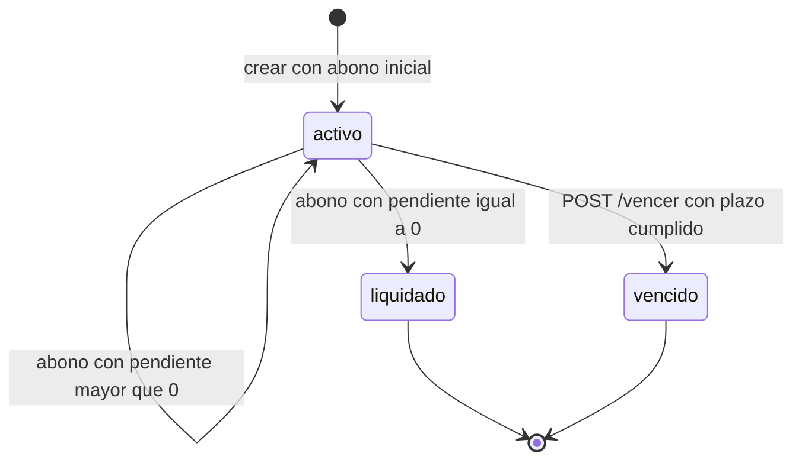
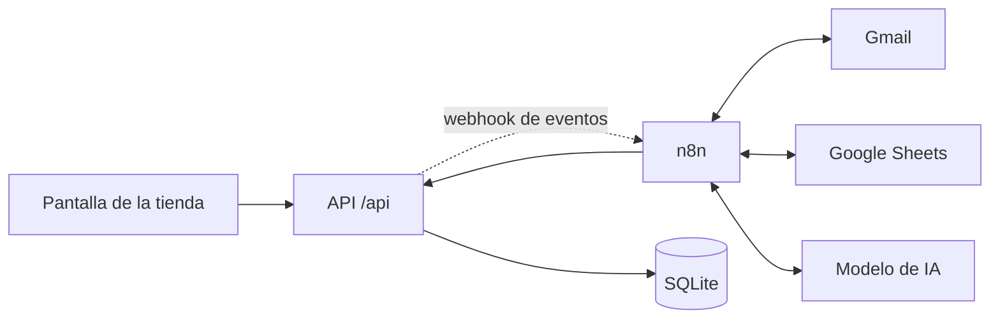

# PRD · Automatizaciones n8n para Zapatería Paso Firme

## Nivel Medio · Esencial + Medio

| Campo | Valor |
|---|---|
| Proyecto | Automatizaciones con n8n · Zapatería Paso Firme |
| Versión | 1.0 |
| Fecha | Octubre 2026 |
| Estado | Aprobado para desarrollo |
| Alcance | Niveles Esencial y Medio: flujos 1 a 9 |
| Canal de notificación | Gmail (clientes y tienda) |
| Equipo | Pareja de desarrollo + agente de IA |
| Documentos base | [Briefing](BRIEFING_zapateria.md) · [Guía de la app](guia-de-la-app.md) |
| Diagramas | [Flujo de usuario](diagramas/flujo-usuario-nivel-medio.md) · [Automatización n8n](diagramas/automatizacion-n8n-nivel-medio.md) |
| Versión completa | [PRD del proyecto completo](prd-completo.md) |

---

## 1. Resumen ejecutivo

Zapatería Paso Firme lleva sus apartados en una libreta y sus ventas en un Excel. La app actual ya sustituye la libreta para registrar apartados, abonos y ventas, y expone una API y un webhook. Lo que falta es todo lo que ocurre **alrededor** del registro: avisar al cliente, cobrar sin revisar el banco a mano, cerrar la caja, recordar vencimientos, vencer apartados e informar a Marisa.

Este PRD define la automatización de los niveles **Esencial y Medio** con n8n: siete flujos operativos, uno de error y la migración del Excel histórico. El resultado esperado es que Marisa y la dependienta dejen de hacer sumas, de revisar correos del banco y de apuntar avisos en papel, y que el cliente reciba confirmaciones, recibos y recordatorios sin intervención humana.

**Decisión de canal:** todas las notificaciones salen por **Gmail**. No se usa Telegram ni WhatsApp en este alcance.

**Principio rector:** la app es la fuente de verdad. n8n consulta, decide y notifica, pero **no recalcula importes ni estados**. Los importes que se muestran al cliente son los que devuelve la API.

---

## 2. Problema y oportunidad

### 2.1 Situación actual

| Dolor | Cómo se manifiesta | Consecuencia |
|---|---|---|
| Libreta y Excel separados | Cada abono se busca y se resta a mano | Errores de saldo y discusiones con el cliente |
| Sin avisos de vencimiento | Nadie llama al cliente antes del plazo | Zapatos ocupando almacén y apartados olvidados |
| Cierre de caja manual | Calculadora al final del día | Tarde, con errores y sin desglose fiable |
| Cobros por Bizum o transferencia | Marisa revisa el correo del banco y adivina el apartado | Pagos sin apuntar o apuntados mal |
| Sin visión de pendiente | No hay un total de lo que falta por cobrar | Decisiones de compra y caja a ciegas |
| Sin trazabilidad de errores | Una automatización puede fallar en silencio | Semanas sin saber que algo dejó de funcionar |

> **Nota:** un **punto de dolor** es una fricción concreta del proceso actual que obliga a trabajar a mano, duplicar información o asumir errores. En la tabla, `Dolor` nombra el problema, `Cómo se manifiesta` lo aterriza en el día a día y `Consecuencia` explica su impacto. No es una solución ni un requisito.

### 2.2 Oportunidad

La app ya aplica las reglas del negocio y emite eventos. n8n puede convertir esos eventos en una operación completa:

- **Cliente:** recibe confirmación, recibo, recordatorio y vale sin pedirlo.
- **Dependienta:** sigue usando la misma pantalla; no aprende una herramienta nueva.
- **Marisa:** recibe la caja cerrada, el informe mensual y avisos solo cuando hace falta decidir.
- **Equipo:** flujos versionados en Git, con pruebas y errores visibles.

---

## 3. Objetivos

### 3.1 Objetivo general

Automatizar el ciclo completo del apartado y la operación diaria de la tienda con n8n, manteniendo la app como única fuente de verdad y sin incorporar trabajo manual nuevo.

### 3.2 Objetivos específicos

| ID | Objetivo | Medición |
|---|---|---|
| OE-01 | Confirmar cada apartado al cliente en menos de un minuto | 100 % de apartados con email y notificación en menos de 60 s |
| OE-02 | Enviar un recibo por cada abono y un mensaje distinto al liquidar | 100 % de eventos `abono.registrado` notificados |
| OE-03 | Registrar solos los abonos que llegan por Bizum o transferencia | 9 de 9 correos de `data/correos/` resueltos correctamente |
| OE-04 | Cerrar la caja cada noche sin calculadora | Cierre disponible antes de las 22:00 |
| OE-05 | Avisar de vencimientos y vencer apartados fuera de plazo | Recordatorios a 7 y 1 días; 0 duplicados |
| OE-06 | Dar a Marisa el informe mensual y el pendiente de cobro | Informe el día 1 antes de las 10:00 |
| OE-07 | Detectar fallos de automatización | Aviso de error en menos de 5 minutos |

### 3.3 No objetivos de este nivel

- Asistente conversacional para clientes o Marisa.
- Panel visual para Marisa.
- Despliegue en la nube, PostgreSQL, copias de seguridad y CI.
- Entrada automática de apartados desde casa o del datáfono.
- Campañas de marketing o mensajes promocionales.

Estos puntos se documentan en el [PRD completo](prd-completo.md) como evolución.

---

## 4. Personas y roles

| Persona | Rol en el producto | Necesidad principal | Canal |
|---|---|---|---|
| **Marisa** | Dueña | Saber cuánto ha cobrado, cuánto le deben y qué apartados requieren decisión | Gmail |
| **Dependienta** | Usuaria de la app | Registrar apartados, abonos y ventas sin cambiar su forma de trabajar | Pantalla de la app |
| **Cliente presencial** | Compra o aparta en tienda | Saber qué ha apartado, cuánto debe y hasta cuándo | Gmail |
| **Cliente remoto** | Paga por Bizum o transferencia | Que su pago se registre y recibir su recibo | Gmail |
| **Equipo de desarrollo** | Pareja + agente de IA | Construir, probar y versionar flujos con seguridad | Git, n8n, OpenCode |

### 4.1 Historias de usuario cubiertas

| Nivel | Historias |
|---|---|
| Esencial | HU-01, HU-02, HU-03, HU-04, HU-05 |
| Medio | HU-06, HU-07, HU-08, HU-09, HU-10 |

Los criterios de aceptación originales se mantienen y se concretan en la sección 9. La trazabilidad está en la sección 18.

---

## 5. Alcance

### 5.1 Flujos incluidos

| ID | Flujo | Disparador | Resultado |
|---|---|---|---|
| FL-01 | Confirmación de apartado | Evento `apartado.creado` | Email al cliente con resumen; aviso a Marisa si no hay email |
| FL-02 | Recibo de abono | Evento `abono.registrado` | Email con importe y pendiente; mensaje especial si queda liquidado |
| FL-03 | Abonos a distancia | Correo nuevo en Gmail | Abono registrado o consulta a Marisa; nunca ambos |
| FL-04 | Venta grande | Evento `venta.registrada` | Email a Marisa si supera el umbral configurado |
| FL-05 | Cierre diario | Schedule Trigger cada noche | Cierre por forma de pago en Google Sheets y email a Marisa |
| FL-06 | Recordatorios y vencimientos | Schedule Trigger cada mañana | Avisos a 7 y 1 días, vencimiento por API y vale |
| FL-07 | Informe mensual | Schedule Trigger el día 1 | Informe del mes anterior y pendiente total |
| FL-08 | Error Workflow | Error en cualquier flujo | Email con flujo, nodo y error, sin secretos |
| FL-09 | Migración del Excel | Ejecución manual | Apartados, abonos y ventas históricos cargados por API |

### 5.2 Fuera de alcance

| Elemento | Motivo |
|---|---|
| Telegram, WhatsApp o SMS | Decisión de producto: solo Gmail |
| Asistente de IA para clientes o Marisa | Nivel Avanzado |
| Panel de Marisa | Nivel Experto |
| Despliegue cloud, HTTPS, PostgreSQL y backups | Nivel Experto |
| CI de validación de JSON | Nivel Experto |
| Servidor MCP *(Model Context Protocol)* | Nivel Experto |
| Cambios en la app | La app se consume tal cual; cualquier cambio se propone aparte |

### 5.3 Dependencias con la app

- La app debe estar levantada y el flujo del webhook **publicado** en n8n.
- La app envía los avisos una sola vez y **sin reintentos**. Los flujos programados no deben depender de haber recibido un aviso: consultan la API.
- La app solo admite `efectivo`, `tarjeta` y `bizum` como formas de pago.
- La app no guarda la fecha de liquidación de un apartado.
- La app no ofrece endpoint de solicitudes, consentimientos ni idempotencia.

---

## 6. Reglas de negocio

### 6.1 Reglas del apartado

| Regla | Detalle | Dónde se aplica |
|---|---|---|
| Abono inicial | Mínimo 5 € y no más que el precio | App |
| Plazo | `fecha_limite = fecha + 90 días` | App |
| Abonos | De cualquier importe, nunca más que lo pendiente | App |
| Liquidación | Si `pendiente = 0`, estado `liquidado` | App, automático |
| Vencimiento | Si `hoy > fecha_limite`, puede vencerse por API | App + FL-06 |
| Un apartado = un par | Un producto y una talla por apartado | App |
| Formas de pago | `efectivo`, `tarjeta`, `bizum` | App |
| Vencido | Genera un vale por lo abonado; no se devuelve efectivo | App |

### 6.2 Estados



Notas:

- `liquidado` lo pone la app sola.
- `vencido` **no** lo pone la app sola: lo provoca FL-06 llamando a `POST /api/apartados/{id}/vencer`.
- `liquidado` y `vencido` son finales y no admiten abonos.

### 6.3 Cálculos

La app calcula y devuelve estos valores. n8n los usa tal cual.

| Métrica | Fórmula | Fuente |
|---|---|---|
| Abonado | Suma de abonos del apartado | `apartado.abonado` |
| Pendiente | `precio - abonado` | `apartado.pendiente` |
| Ventas del día | Ventas directas + abonos del día, incluidos los abonos iniciales | `GET /api/ventas` + `GET /api/abonos` |
| Recaudación mensual | Ventas directas + abonos del mes | Mismas consultas con rango mensual |
| Total pendiente de cobro | Suma de `pendiente` de todos los apartados `activo` | `GET /api/apartados?estado=activo` |

> **Regla de oro:** si n8n necesita un importe, lo lee de la API. No lo recalcula, no lo redondea a mano y no se lo pide a la IA.

### 6.4 Formas de pago y transferencias

La app no tiene una forma de pago `transferencia`. Para no rechazar pagos reales:

- Bizum se registra como `bizum`.
- Transferencia se registra como `bizum`, indicando en el email a Marisa que el origen era una transferencia.
- Esta decisión es un **supuesto a confirmar** con Marisa. Si se prefiere otro mapeo, se cambia en FL-03 sin tocar la app.

### 6.5 Umbral de venta grande

- Se guarda en la variable de n8n `VENTA_GRANDE_UMBRAL`.
- Se avisa cuando `importe > umbral`.
- Cambiar el umbral no requiere editar el flujo.
- Valor inicial propuesto: 100 €, pendiente de confirmación.

---

## 7. Experiencia de usuario

### 7.1 Recorrido

El detalle visual está en [flujo de usuario · nivel medio](diagramas/flujo-usuario-nivel-medio.md). Resume el proceso actual (libreta, Excel, calculadora) y el proceso automatizado.

### 7.2 Escenarios principales

| ID | Escenario | Actor | Resultado esperado |
|---|---|---|---|
| E-01 | Apartado presencial con abono inicial | Dependienta + cliente | Apartado creado y email de confirmación |
| E-02 | Abono presencial | Dependienta + cliente | Recibo con pendiente actualizado |
| E-03 | Abono que liquida | Dependienta + cliente | Mensaje de “puede recoger sus zapatos” |
| E-04 | Pago remoto por Bizum o transferencia | Cliente + Marisa | Abono registrado o consulta a Marisa |
| E-05 | Venta directa grande | Dependienta + Marisa | Email de aviso a Marisa |
| E-06 | Cierre del día | Marisa | Resumen por forma de pago |
| E-07 | Recordatorio y vencimiento | Cliente + Marisa | Aviso, vale y lista de zapatos que vuelven a la venta |
| E-08 | Informe mensual | Marisa | Recaudación, pendiente y movimientos del mes |
| E-09 | Fallo de un flujo | Marisa | Email de error con contexto |
| E-10 | Migración del Excel | Equipo + Marisa | Datos cargados y informe de incidencias |

### 7.3 Casos de excepción del pago remoto

| Correo | Situación | Decisión | Resultado |
|---|---|---|---|
| `01_bizum_carmen` | Nombre único activo | Registrar 10 € | Recibo al cliente |
| `02_bizum_jorge` | Ordenante abreviado, concepto con nº de apartado | Registrar 20 € en el apartado indicado | Recibo al cliente |
| `03_transferencia_lucia` | Paga justo lo pendiente | Registrar | Apartado `liquidado` y mensaje de recogida |
| `04_bizum_laura` | Paga más de lo pendiente | No registrar | Email a Marisa con motivo |
| `05_bizum_romero` | Solo apellido e inicial, sin concepto | No registrar | Email a Marisa para que decida |
| `06_bizum_paula` | Apartado fuera de plazo | No registrar | Email a Marisa con motivo |
| `07_transferencia_desconocido` | No coincide con ningún cliente | No registrar | Email a Marisa para que identifique |
| `08_publicidad_banco` | No es un pago | Ignorar | Sin acción y sin ruido |
| `09_bizum_silvia` | Nombre único activo | Registrar 5 € | Recibo al cliente |

**Regla:** si hay cualquier duda, no se registra nada y se pregunta a Marisa. La IA solo extrae datos; la decisión la toma el flujo con la API.

---

## 8. Arquitectura

### 8.1 Componentes

| Componente | Función | Dirección |
|---|---|---|
| App de la tienda | Fuente de verdad, reglas y datos | `http://tienda:8000` desde n8n |
| API REST | Consultas y acciones de n8n | `X-API-Key` |
| Webhook | Avisos de la app a n8n | `POST http://n8n:5678/webhook/tienda` |
| n8n | Orquestación, decisiones y notificaciones | Docker |
| Gmail | Entrada de avisos del banco y salida de mensajes | OAuth2 |
| Google Sheets | Cierres, avisos enviados, correos procesados y migración | OAuth2 |
| Modelo de IA | Extracción de datos del correo del banco | API gratuita |

### 8.2 Integración



### 8.3 Webhook único

- Método: `POST`.
- Path: `tienda`.
- URL de producción: `http://n8n:5678/webhook/tienda`.
- URL de prueba: `http://n8n:5678/webhook-test/tienda`.
- Cuerpo: `{ "evento": "...", "datos": { ... } }`.
- En n8n se lee `{{ $json.body.evento }}` y `{{ $json.body.datos }}`.
- Un **Switch** reparte por `body.evento`.

| Evento | Rama | Nota |
|---|---|---|
| `apartado.creado` | FL-01 | Confirmación al cliente |
| `abono.registrado` | FL-02 | Recibo; incluye `importe` del abono |
| `venta.registrada` | FL-04 | Aviso si supera el umbral |
| `apartado.vencido` | Auditoría | FL-06 ya notifica con la respuesta de la API; no se reenvía para evitar duplicados |
| Desconocido | Log | Sin email para no generar ruido |

**Trampa operativa:** la app usa la Production URL. Si el flujo no está publicado, n8n responde 404 y el aviso se pierde. La app no reintenta.

### 8.4 Endpoints usados

| Endpoint | Uso | Flujos |
|---|---|---|
| `GET /api/apartados` | Listar y buscar apartados | FL-03, FL-06, FL-07 |
| `GET /api/apartados/resumen` | Conteo por estado | FL-07 |
| `GET /api/apartados/{id}` | Detalle con abonos y vale | FL-03, FL-06 |
| `POST /api/apartados` | Crear apartado | FL-09 |
| `POST /api/apartados/{id}/abonos` | Registrar abono | FL-03, FL-09 |
| `POST /api/apartados/{id}/vencer` | Vencer y generar vale | FL-06 |
| `GET /api/abonos` | Abonos entre fechas | FL-05, FL-07, FL-09 |
| `GET /api/ventas` | Ventas entre fechas | FL-05, FL-07 |
| `POST /api/ventas` | Registrar venta | FL-09 |
| `GET /api/vales` | Vales generados | FL-07 |

### 8.5 Credenciales y variables

Ningún valor se escribe en los nodos ni se sube al repositorio.

| Tipo | Nombre | Uso |
|---|---|---|
| Header Auth | `PF · API tienda` | Cabecera `X-API-Key` en todos los HTTP Request |
| OAuth2 | `PF · Gmail` | Leer correos y enviar mensajes |
| OAuth2 | `PF · Google Sheets` | Cierres, avisos, correos y migración |
| API Key | `PF · IA` | Extracción del correo del banco |
| Variable | `MARISA_EMAIL` | Destino de avisos internos |
| Variable | `TIENDA_EMAIL` | Remitente y respuestas |
| Variable | `VENTA_GRANDE_UMBRAL` | Umbral de aviso |
| Variable | `BANCO_REMITENTES` | Filtro de correos del banco |
| Variable | `ZONA_HORARIA` | `Europe/Madrid` |

### 8.6 Almacenamiento auxiliar

Solo para lo que la app no guarda.

| Hoja | Clave | Para qué |
|---|---|---|
| `Cierres` | `fecha` | Histórico del cierre diario |
| `Avisos` | `apartado_id + tipo + fecha_limite` | Evitar recordatorios duplicados |
| `Emails` | `message_id` | Evitar procesar dos veces el mismo correo |
| `Migracion` | `hash_fila` | Evitar duplicados al repetir la migración |

### 8.7 Convenciones

| Elemento | Convención | Ejemplo |
|---|---|---|
| Workflow | `PF · FL-0X · Nombre` | `PF · FL-01 · Confirmación de apartado` |
| Sub-workflow | `PF · SUB · Nombre` | `PF · SUB · Buscar apartado` |
| Nodo | `FL0X · Nombre` | `FL03 · Extraer datos` |
| JSON | `workflows/fl-0x-nombre.json` | `workflows/fl-01-confirmacion-apartado.json` |
| Tag | `paso-firme`, `nivel-medio`, `fl-0x` | — |

---

## 9. Requisitos funcionales

### 9.1 Orquestación

| ID | Requisito |
|---|---|
| RF-01 | Un único Webhook `POST /webhook/tienda` recibe todos los eventos. |
| RF-02 | Un Switch reparte por `body.evento`; los eventos desconocidos se registran sin generar email. |
| RF-03 | Todos los HTTP Request usan la credencial Header Auth con `X-API-Key`. |
| RF-04 | Los flujos leen `body.datos`; no esperan el evento en la raíz. |
| RF-05 | Los flujos tratan los errores `401`, `404` y `422` sin romper la ejecución completa. |

### 9.2 FL-01 · Confirmación de apartado

**Disparador:** `apartado.creado`.
**Entradas:** apartado con `cliente`, `email`, `producto`, `talla`, `precio`, `abonado`, `pendiente`, `fecha_limite`.

**Pasos:**

1. Validar que existen los campos mínimos.
2. Si hay `email`, enviar confirmación al cliente.
3. Si no hay `email`, enviar aviso a Marisa con los datos y el motivo.
4. Registrar la ejecución; no recalcular importes.

**Mensaje:** modelo, talla, precio, abonado, pendiente y fecha límite.

**Errores:** un email ausente no es un fallo del flujo. Un fallo de Gmail se reintenta y, si persiste, va al Error Workflow.

| ID | Requisito |
|---|---|
| RF-06 | Enviar la confirmación en menos de un minuto cuando hay email. |
| RF-07 | Incluir modelo, talla, precio, abonado, pendiente y fecha límite. |
| RF-08 | Usar los importes de la app, sin recalcular. |
| RF-09 | Si no hay email, avisar a Marisa y no fallar. |

**Criterios de aceptación:**

- [ ] Al crear un apartado con email, el cliente recibe el mensaje en menos de un minuto.
- [ ] El mensaje contiene los seis datos obligatorios.
- [ ] Los importes coinciden con `GET /api/apartados/{id}`.
- [ ] Sin email, Marisa recibe el aviso y la ejecución termina correctamente.

### 9.3 FL-02 · Recibo de abono

**Disparador:** `abono.registrado`.
**Entradas:** apartado actualizado + `importe` del abono.

**Pasos:**

1. Leer `importe`, `abonado`, `pendiente` y `estado`.
2. Si `estado = liquidado`, enviar mensaje de recogida.
3. Si sigue `activo`, enviar recibo con importe y pendiente.
4. Si no hay email, avisar a Marisa.

| ID | Requisito |
|---|---|
| RF-10 | Cada abono genera un recibo con importe pagado y pendiente. |
| RF-11 | Si el apartado queda `liquidado`, el mensaje cambia y avisa de la recogida. |
| RF-12 | Los importes salen del evento o de la API, nunca de un cálculo propio. |
| RF-13 | Sin email, se avisa a Marisa sin romper el flujo. |

**Criterios de aceptación:**

- [ ] Un abono parcial genera un recibo con el pendiente correcto.
- [ ] Un abono que deja `pendiente = 0` genera el mensaje de recogida.
- [ ] El recibo usa `importe` del evento y `pendiente` actualizado.
- [ ] Un apartado sin email genera aviso interno.

### 9.4 FL-03 · Abonos a distancia

**Disparador:** Gmail Trigger cada minuto, filtrado por remitentes del banco y etiqueta `Banco`.

**Entradas:** asunto y cuerpo del correo.

**Pasos:**

1. Comprobar `message_id` en `Emails`. Si ya se procesó, terminar.
2. Enviar al modelo solo el texto necesario y pedir un JSON con `es_pago`, `tipo`, `ordenante`, `importe`, `concepto` y `referencia_apartado`.
3. Validar el JSON con un nodo Code. Si no es válido, preguntar a Marisa.
4. Si no es un pago, marcar como ignorado y terminar.
5. Resolver el apartado:
   - primero, por número de apartado en el concepto;
   - después, por nombre normalizado contra apartados activos;
   - si el nombre está completo y hay un único activo, se usa aunque el concepto no coincida con el producto;
   - si el nombre es abreviado, usar el concepto para desambiguar; sin concepto, no emparejar y preguntar;
   - si hay 0 o más de 1 coincidencia, preguntar a Marisa.
6. Validar con la API: estado `activo`, plazo vigente e importe menor o igual que el pendiente.
7. Si todo es correcto, `POST /api/apartados/{id}/abonos` con `forma_pago: "bizum"` y la fecha de hoy.
8. Marcar el correo como procesado.
9. El evento `abono.registrado` dispara FL-02 y el cliente recibe su recibo.

**Extracción esperada:**

```json
{
  "es_pago": true,
  "tipo": "bizum",
  "ordenante": "CARMEN RUIZ GARCIA",
  "importe": 10.00,
  "concepto": "zuecos",
  "referencia_apartado": null
}
```

| ID | Requisito |
|---|---|
| RF-14 | Ignorar correos que no son pagos. |
| RF-15 | Extraer ordenante, importe, concepto y referencia con IA. |
| RF-16 | Validar el JSON extraído antes de usarlo. |
| RF-17 | Resolver el apartado por referencia y, si no, por nombre normalizado; usar el concepto solo para desambiguar nombres abreviados o varias coincidencias. |
| RF-18 | No registrar si hay 0 o varias coincidencias, si el apartado no está activo, si está fuera de plazo, si el importe supera el pendiente o si no hay concepto y el ordenante solo tiene apellido e inicial. |
| RF-19 | Avisar a Marisa con el motivo y los datos del correo cuando no se registra. |
| RF-20 | No procesar dos veces el mismo `message_id`. |
| RF-21 | La IA no decide el importe, el apartado ni la validez; solo extrae. |

**Criterios de aceptación:**

- [ ] Los 9 correos de `data/correos/` producen el resultado de la tabla 7.3.
- [ ] Un pago válido aparece en la app y genera recibo.
- [ ] Un pago dudoso no aparece en la app y genera email a Marisa.
- [ ] Repetir la ejecución sobre el mismo correo no duplica el abono.

### 9.5 FL-04 · Venta grande

**Disparador:** `venta.registrada`.
**Entradas:** venta con `concepto`, `importe`, `forma_pago`.

| ID | Requisito |
|---|---|
| RF-22 | Si `importe > VENTA_GRANDE_UMBRAL`, enviar email a Marisa. |
| RF-23 | El umbral se lee de una variable de n8n, no de un valor fijo en el nodo. |
| RF-24 | Si no supera el umbral, terminar sin enviar nada. |

**Criterios de aceptación:**

- [ ] Una venta por encima del umbral genera aviso.
- [ ] Una venta por debajo no genera aviso.
- [ ] Cambiar la variable cambia el comportamiento sin editar el flujo.

### 9.6 FL-05 · Cierre diario

**Disparador:** Schedule Trigger diario a las 21:30, zona `Europe/Madrid`.

**Pasos:**

1. Calcular `hoy`.
2. `GET /api/ventas?desde=hoy&hasta=hoy`.
3. `GET /api/abonos?desde=hoy&hasta=hoy`.
4. Agrupar por `forma_pago` y sumar.
5. Guardar o actualizar la fila de `hoy` en `Cierres`.
6. Enviar email a Marisa con el desglose y el total.
7. Si no hay movimientos, enviar “Sin movimientos hoy” con totales a 0.

| ID | Requisito |
|---|---|
| RF-25 | Incluir ventas directas y abonos, separados por efectivo, tarjeta y bizum. |
| RF-26 | Incluir el total del día y los totales por concepto. |
| RF-27 | Guardar el cierre por fecha sin duplicar si se reejecuta. |
| RF-28 | Informar de un día sin movimientos sin fallar. |
| RF-29 | Los importes deben coincidir con la app. |

**Criterios de aceptación:**

- [ ] El email muestra ventas, abonos y total por forma de pago.
- [ ] El total coincide con la suma de las consultas de la API.
- [ ] Reejecutar el mismo día actualiza la fila, no crea otra.
- [ ] Un día sin movimientos genera un email claro con 0 €.

### 9.7 FL-06 · Recordatorios y vencimientos

**Disparador:** Schedule Trigger diario a las 08:00, zona `Europe/Madrid`.

**Pasos:**

1. `GET /api/apartados?estado=activo` sin paginación.
2. Para cada apartado, calcular los días hasta `fecha_limite`.
3. Si faltan 7 días o 1 día, enviar recordatorio si no se envió ya.
4. Si `hoy > fecha_limite`, llamar a `POST /api/apartados/{id}/vencer`.
5. Con la respuesta, enviar al cliente el vale y a Marisa la lista de zapatos que vuelven a la venta.
6. Registrar avisos y vencimientos para evitar duplicados.

| ID | Requisito |
|---|---|
| RF-30 | Avisar a 7 días y a 1 día, una sola vez por apartado y tipo. |
| RF-31 | Incluir pendiente y fecha límite en el recordatorio. |
| RF-32 | Vencer solo apartados con `hoy > fecha_limite` y estado `activo`. |
| RF-33 | Enviar al cliente el código y el importe del vale. |
| RF-34 | Enviar a Marisa la lista de productos que vuelven a la venta. |
| RF-35 | No duplicar avisos ni vencimientos al reejecutar. |
| RF-36 | Si no hay email, avisar a Marisa y continuar con el resto. |

**Criterios de aceptación:**

- [ ] Un apartado que vence en 7 días recibe un único recordatorio.
- [ ] Un apartado que vence mañana recibe un único recordatorio.
- [ ] Un apartado fuera de plazo pasa a `vencido` y genera vale.
- [ ] El cliente recibe código e importe del vale.
- [ ] Marisa recibe la lista de zapatos que vuelven a la venta.
- [ ] Reejecutar el flujo no duplica avisos.

### 9.8 FL-07 · Informe mensual

**Disparador:** Schedule Trigger el día 1 a las 08:00, zona `Europe/Madrid`.

**Pasos:**

1. Calcular el mes anterior.
2. Consultar ventas y abonos del mes.
3. Consultar apartados activos y sumar `pendiente`.
4. Contar apartados nuevos por `fecha`.
5. Contar liquidados y vencidos del mes con las limitaciones de la sección 17.
6. Enviar email a Marisa con tabla y totales.
7. Si no hay datos, enviar el informe con ceros y una nota.

| ID | Requisito |
|---|---|
| RF-37 | Incluir recaudación del mes separada en ventas directas y abonos. |
| RF-38 | Incluir total pendiente de cobro de apartados activos. |
| RF-39 | Incluir apartados nuevos, liquidados y vencidos del mes. |
| RF-40 | Los importes deben coincidir con la app. |
| RF-41 | Gestionar un mes sin datos sin fallar. |

**Criterios de aceptación:**

- [ ] El informe llega el día 1 antes de las 10:00.
- [ ] La recaudación coincide con las consultas de la API.
- [ ] El pendiente coincide con la suma de apartados activos.
- [ ] El informe distingue ventas directas y abonos.
- [ ] Un mes sin datos genera un informe con ceros.

### 9.9 FL-08 · Error Workflow

**Disparador:** Error Trigger configurado en cada workflow.

| ID | Requisito |
|---|---|
| RF-42 | Avisar a Marisa con nombre del flujo, nodo, mensaje de error y enlace a la ejecución. |
| RF-43 | No incluir contraseñas, claves ni cuerpos completos de correos. |
| RF-44 | Todos los workflows tienen configurado este Error Workflow. |

**Criterios de aceptación:**

- [ ] Un fallo provocado en cualquier flujo genera un email.
- [ ] El email identifica flujo, nodo y error.
- [ ] El email no contiene secretos.
- [ ] El Error Workflow no se llama a sí mismo en bucle.

### 9.10 FL-09 · Migración del Excel

**Disparador:** ejecución manual.
**Entradas:** `data/excel_actual_apartados.csv` y `data/excel_actual_ventas.csv`.

**Normalización:**

- Fechas `DD/MM/YYYY` y `D/M/YY` a `YYYY-MM-DD`.
- Nombres con espacios, mayúsculas y caracteres mal codificados.
- Importes con `€`, separador de miles y coma decimal.
- Teléfonos ausentes: se permiten.
- `resta` y `notas` son informativos; no se usan para calcular.

**Reglas de carga:**

1. Agrupar filas por cliente, producto, talla y teléfono.
2. La primera fila de cada grupo es el alta con abono inicial.
3. Las filas marcadas como abono son abonos adicionales.
4. Crear el apartado con `POST /api/apartados` y su fecha original.
5. Registrar los abonos adicionales con `POST /api/apartados/{id}/abonos` y su fecha original.
6. Ignorar filas de totales.
7. No importar como venta las filas que en realidad son abonos.
8. Si el abono inicial es menor que 5 €, no cargar el grupo y reportarlo.
9. Ejecutar dos veces no duplica: usar `Migracion` y comprobar antes de crear.

**Resultado esperado con los CSV de ejemplo:**

| Concepto | Esperado |
|---|---|
| Apartados únicos en el CSV | 8 |
| Apartados cargados | 7 |
| Caso dudoso | Lucía Gómez: abono inicial de 4 €; no se carga y se reporta |
| Abonos cargados | 10 (7 iniciales + 3 adicionales) |
| Ventas reales | 6 |
| Filas de abono dentro del CSV de ventas | 3, ignoradas |
| Fila de total | 1, ignorada |

| ID | Requisito |
|---|---|
| RF-45 | Leer y normalizar ambos CSV. |
| RF-46 | Crear apartados y abonos por API con fecha original. |
| RF-47 | No duplicar al ejecutar dos veces. |
| RF-48 | No cargar casos dudosos y reportarlos. |
| RF-49 | Enviar a Marisa un informe con cargados, ignorados y motivos. |

**Criterios de aceptación:**

- [ ] Los 7 apartados válidos existen en la app con su fecha original.
- [ ] Los abonos quedan con su fecha original.
- [ ] Lucía aparece en el informe como caso dudoso y no en la app.
- [ ] Las 3 filas de abono del CSV de ventas no se duplican como ventas.
- [ ] La segunda ejecución no crea nada nuevo.
- [ ] El informe final cuadra con la app.

---

## 10. Requisitos no funcionales

| ID | Categoría | Requisito |
|---|---|---|
| RNF-01 | Seguridad | Toda llamada a `/api` lleva `X-API-Key`; sin clave, la app responde 401. |
| RNF-02 | Secretos | Ninguna credencial, token o clave se escribe en nodos ni en JSON versionados. |
| RNF-03 | Privacidad | A la IA solo se envía el texto imprescindible del correo; no se envían listados completos de clientes. |
| RNF-04 | RGPD | Los mensajes al cliente son transaccionales; cualquier uso no esencial requiere consentimiento registrado. |
| RNF-05 | Idempotencia | FL-03, FL-05, FL-06 y FL-09 pueden reejecutarse sin duplicar efectos. |
| RNF-06 | Reintentos | Los HTTP Request reintentan 3 veces con espera creciente ante errores 5xx o timeout. |
| RNF-07 | Errores de negocio | Los 4xx esperados se tratan con `On Error → Continue` y rama de aviso; no se reintentan. |
| RNF-08 | Observabilidad | Cada flujo deja ejecución en n8n; los errores se alertan en menos de 5 minutos. |
| RNF-09 | Rendimiento | Confirmación y recibo en menos de 1 minuto; trabajos programados en menos de 5 minutos. |
| RNF-10 | Disponibilidad | Los flujos programados consultan la API y no dependen de un webhook que pudo perderse. |
| RNF-11 | Mantenibilidad | Un workflow por flujo, sub-workflows reutilizables y nombres con convención. |
| RNF-12 | Portabilidad | Todo funciona con `docker compose` y zona horaria `Europe/Madrid`. |
| RNF-13 | Coste | Solo modelos gratuitos y capas gratuitas de Gmail y Google Sheets. |
| RNF-14 | Integridad | Importes con dos decimales y en EUR; la app es la única calculadora. |

---

## 11. Datos y modelo

### 11.1 Entidades

| Entidad | Campos principales | Origen |
|---|---|---|
| Cliente | `cliente`, `telefono`, `email` | App |
| Apartado | `id`, `fecha`, `producto`, `talla`, `precio`, `abonado`, `pendiente`, `fecha_limite`, `estado` | App |
| Abono | `id`, `apartado_id`, `fecha`, `importe`, `forma_pago` | App |
| Venta | `id`, `fecha`, `concepto`, `importe`, `forma_pago` | App |
| Vale | `id`, `codigo`, `apartado_id`, `fecha`, `importe`, `usado` | App |
| CierreDiario | `fecha`, totales por forma de pago y por tipo | Google Sheets |
| Aviso | `clave`, `apartado_id`, `tipo`, `enviado_en` | Google Sheets |
| CorreoProcesado | `message_id`, `estado`, `motivo`, `apartado_id`, `importe` | Google Sheets |
| FilaMigracion | `hash`, `entidad`, `id_api`, `estado`, `motivo` | Google Sheets |

### 11.2 Eventos

```json
{"evento": "apartado.creado", "datos": {"id": 25, "cliente": "Carmen Ruiz", "email": "carmen@example.com", "producto": "Botín piel marrón", "talla": "38", "precio": 89.9, "abonado": 10.0, "pendiente": 79.9, "fecha_limite": "2027-01-18", "estado": "activo"}}
```

```json
{"evento": "abono.registrado", "datos": {"id": 25, "cliente": "Carmen Ruiz", "email": "carmen@example.com", "producto": "Botín piel marrón", "precio": 89.9, "abonado": 30.0, "pendiente": 59.9, "fecha_limite": "2027-01-18", "estado": "activo", "importe": 20.0}}
```

```json
{"evento": "venta.registrada", "datos": {"id": 257, "fecha": "2026-10-20", "concepto": "Crema calzado", "importe": 4.5, "forma_pago": "efectivo"}}
```

```json
{"evento": "apartado.vencido", "datos": {"apartado": {"id": 16, "estado": "vencido"}, "vale": {"codigo": "VALE-00016", "importe": 5.0}}}
```

### 11.3 Idempotencia

| Flujo | Clave | Almacén | Comportamiento |
|---|---|---|---|
| FL-03 | `message_id` | `Emails` | Si existe, no se vuelve a procesar |
| FL-05 | `fecha` | `Cierres` | Se actualiza la fila del día |
| FL-06 | `apartado_id + tipo + fecha_limite` | `Avisos` | No se repite el aviso |
| FL-09 | `hash_fila` | `Migracion` | No se vuelve a crear |

---

## 12. Seguridad y privacidad

- La app y n8n viven en la red de Docker; en este nivel no se exponen a Internet.
- La API se protege con `X-API-Key`; la credencial se guarda en n8n.
- El webhook de la app no tiene autenticación propia. Es una limitación aceptada mientras no se publique; en el nivel Avanzado se protege con cabecera o Basic Auth.
- No se envían a la IA nombres de todos los clientes ni la base de datos. Solo el cuerpo del correo que se está procesando.
- Los emails de error no incluyen cuerpos completos ni credenciales.
- Los datos personales se usan solo para gestionar el apartado y avisar al cliente.
- Los mensajes de confirmación, recibo, recordatorio y vencimiento son transaccionales y se limitan a los hitos del apartado. En este nivel se envían al email facilitado al crear el apartado; el registro formal de consentimiento se incorpora en el nivel Avanzado.
- Los CSV de migración se tratan como datos personales: no se suben al repositorio ni se adjuntan en informes.

---

## 13. Errores y observabilidad

| Situación | Tratamiento |
|---|---|
| Gmail temporalmente caído | Reintento con espera; si persiste, Error Workflow |
| API 401 | Error de configuración; aviso inmediato y no reintentar en bucle |
| API 422 | Regla de negocio; continuar y avisar a Marisa con `detail` |
| API 404 | Dato inexistente; avisar a Marisa |
| Webhook no publicado | La app registra “No se pudo avisar a n8n”; el flujo programado reconcilia lo que pueda |
| IA devuelve JSON inválido | No registrar; preguntar a Marisa |
| IA devuelve importe raro | Validar con la API; si no cuadra, preguntar |
| Sheets no disponible | Reintento; si persiste, Error Workflow |
| Duplicado de correo | Se detecta por `message_id` y se ignora |
| Error dentro de un flujo | Error Trigger envía email a Marisa |

**Evidencias mínimas:** ejecución en n8n, fila en Sheets, email enviado y captura o vídeo de la demo.

---

## 14. Criterios de aceptación y pruebas

### 14.1 Definición de terminado del nivel

- Los flujos 1 a 9 están exportados en JSON y versionados.
- El webhook único está publicado y recibe los eventos.
- Las credenciales están en n8n, no en el repo.
- El Error Workflow está configurado en todos los flujos.
- Los 9 correos de prueba se resuelven como indica la tabla 7.3.
- La migración se ejecuta dos veces sin duplicar.
- Hay evidencias de ejecución y un README de importación.

### 14.2 Matriz de pruebas

| ID | Prueba | Resultado esperado |
|---|---|---|
| T-01 | Correos `01_bizum_carmen` y `09_bizum_silvia` | Dos abonos registrados y sus recibos |
| T-02 | Correo `02_bizum_jorge` | Abono registrado por referencia |
| T-03 | Correo `03_transferencia_lucia` | Apartado liquidado y mensaje de recogida |
| T-04 | Correo `04_bizum_laura` | Sin registro y aviso a Marisa |
| T-05 | Correo `05_bizum_romero` | Sin registro y consulta a Marisa |
| T-06 | Correo `06_bizum_paula` | Sin registro y aviso por plazo |
| T-07 | Correo `07_transferencia_desconocido` | Sin registro y consulta a Marisa |
| T-08 | Correo `08_publicidad_banco` | Ignorado sin ruido |
| T-09 | Apartado sin email | Aviso a Marisa, sin fallo |
| T-10 | Abono que liquida | Mensaje de recogida |
| T-11 | Venta por encima del umbral | Aviso a Marisa |
| T-12 | Cierre de un día sin movimientos | Email con 0 € |
| T-13 | Recordatorio a 7 días | Un único email |
| T-14 | Recordatorio a 1 día | Un único email |
| T-15 | Apartado fuera de plazo | Vencido, vale y aviso |
| T-16 | Informe mensual | Totales correctos |
| T-17 | Fallo provocado | Email del Error Workflow |
| T-18 | Migración dos veces | Sin duplicados |
| T-19 | API con clave incorrecta | 401 tratado |
| T-20 | Flujo sin publicar | La app no rompe; se detecta en logs |

---

## 15. Métricas de éxito

| ID | Métrica | Objetivo |
|---|---|---|
| KPI-01 | Confirmaciones enviadas en menos de 1 minuto | 100 % |
| KPI-02 | Correos del banco resueltos correctamente | 9 de 9 |
| KPI-03 | Abonos remotos apuntados a mano | 0 |
| KPI-04 | Cierres diarios generados | 100 % de los días con actividad |
| KPI-05 | Recordatorios duplicados | 0 |
| KPI-06 | Informe mensual el día 1 antes de las 10:00 | 100 % |
| KPI-07 | Errores alertados en menos de 5 minutos | 100 % |
| KPI-08 | Secretos en el repositorio | 0 |
| KPI-09 | Duplicados en la migración | 0 |

### Diagramas por HU (Nivel Medio)

- [HU-01 · Confirmación de apartado (FL-01)](diagramas/automatizacion/hu-nivel-medio/hu-01-confirmacion-apartado.md)
- [HU-02 · Recibo de abono (FL-02)](diagramas/automatizacion/hu-nivel-medio/hu-02-recibo-abono.md)
- [HU-03 · Abonos a distancia (FL-03)](diagramas/automatizacion/hu-nivel-medio/hu-03-abonos-a-distancia.md)
- [HU-04 · Venta grande (FL-04)](diagramas/automatizacion/hu-nivel-medio/hu-04-venta-grande.md)
- [HU-05 · Cierre diario (FL-05)](diagramas/automatizacion/hu-nivel-medio/hu-05-cierre-diario.md)
- [HU-06 · Recordatorios y vencimientos (FL-06)](diagramas/automatizacion/hu-nivel-medio/hu-06-recordatorios-vencimientos.md)
- [HU-07 · Informe mensual (FL-07)](diagramas/automatizacion/hu-nivel-medio/hu-07-informe-mensual.md)
- [HU-08 · Error Workflow (FL-08)](diagramas/automatizacion/hu-nivel-medio/hu-08-error-workflow.md)
- [HU-09 · Migración del Excel (FL-09)](diagramas/automatizacion/hu-nivel-medio/hu-09-migracion-excel.md)

---

## 16. Plan de entrega

| Fase | Contenido | Salida |
|---|---|---|
| F-0 | Credenciales, variables, webhook publicado y sub-workflows base | Entorno listo |
| F-1 | FL-01 y FL-02 | Confirmaciones y recibos |
| F-2 | FL-03 | Los 9 correos resueltos |
| F-3 | FL-05 y FL-08 | Cierre diario y errores |
| F-4 | FL-04, FL-06 y FL-07 | Nivel Medio completo |
| F-5 | FL-09 | Migración y informe |
| F-6 | Pruebas, evidencias, README y revisión de seguridad | Entrega |

Cada fase termina con el flujo importado, probado con datos de ejemplo y revisado en una Pull Request.

---

## 17. Riesgos, supuestos y preguntas abiertas

### 17.1 Riesgos

| Riesgo | Impacto | Mitigación |
|---|---|---|
| El webhook se pierde y no hay reintento | Un aviso no se envía | Los flujos programados consultan la API; en el nivel completo se añade reconciliación |
| Gmail tiene cuotas o fallos | Notificaciones retrasadas | Reintentos, cuenta dedicada y monitorización |
| La IA alucina un importe o un cliente | Abono incorrecto | Validación con API; la IA solo extrae; duda = consulta a Marisa |
| Transferencia mal mapeada a `bizum` | Informe por forma de pago impreciso | Supuesto documentado; confirmar con Marisa |
| No hay fecha de liquidación | Informe mensual aproximado | Usar último abono; proponer cambio de app en el futuro |
| Recordatorios duplicados | Molestia al cliente | Clave en `Avisos` |
| Migración duplicada | Datos sucios | `Migracion` + comprobación previa |
| Webhook expuesto sin autenticación | Riesgo de spam | No publicar en este nivel; proteger en Avanzado |
| Modelo gratuito con límites | Bloqueo temporal | Cola, reintento y aviso a Marisa |
| CSV con datos ambiguos | Pérdida de histórico | Informe de incidencias y decisión humana |

### 17.2 Supuestos

- La app se mantiene sin cambios.
- Marisa acepta Gmail como único canal.
- La transferencia se registra como `bizum`.
- El umbral inicial de venta grande es 100 €.
- El cierre se ejecuta a las 21:30 y los recordatorios a las 08:00.
- Google Sheets es aceptable para cierres, avisos y migración.
- Los clientes con email en la app aceptan mensajes transaccionales del apartado.

### 17.3 Preguntas abiertas

1. ¿Confirmas que una transferencia debe registrarse como `bizum`?
2. ¿Qué importe exacto debe considerarse venta grande?
3. ¿Qué remitentes y asuntos usa el banco en producción?
4. ¿Quién recibe los avisos internos: Marisa, la dependienta o ambos?
5. ¿Se permite usar un Form Trigger solo para pruebas del flujo 3?
6. ¿Google Sheets o una tabla interna de n8n para la idempotencia?
7. ¿Los recordatorios requieren consentimiento adicional o se consideran transaccionales?
8. ¿Se puede cambiar la hora del cierre si la tienda cierra más tarde?

---

## 18. Trazabilidad

| HU | Flujo | Requisitos | Pruebas |
|---|---|---|---|
| HU-01 | FL-01 | RF-06 a RF-09 | T-01, T-09 |
| HU-02 | FL-02 | RF-10 a RF-13 | T-03, T-10 |
| HU-03 | FL-03 | RF-14 a RF-21 | T-01 a T-08 |
| HU-04 | FL-05 | RF-25 a RF-29 | T-12 |
| HU-05 | FL-08 | RF-42 a RF-44 | T-17 |
| HU-06 | FL-06 | RF-30, RF-31, RF-35, RF-36 | T-13, T-14 |
| HU-07 | FL-06 | RF-32 a RF-36 | T-15 |
| HU-08 | FL-07 | RF-37 a RF-41 | T-16 |
| HU-09 | FL-04 | RF-22 a RF-24 | T-11 |
| HU-10 | FL-09 | RF-45 a RF-49 | T-18 |

---

## 19. Anexos

### A. Estructura de la app

| Capa | Carpeta | Qué aporta |
|---|---|---|
| Modelo | `backend/models/` | Reglas y cálculos |
| Schemas | `backend/schemas/` | Forma de los datos |
| Rutas | `backend/routes/` | Endpoints |
| Controladores | `backend/controllers/` | Lógica de cada petición |
| Middleware | `backend/middleware/` | Clave y errores |
| Servicio n8n | `backend/services/n8n.py` | Envío del webhook |
| Vista | `frontend/` | Pantalla de la dependienta |

### B. Endpoints y errores

| Código | Significado | Acción en n8n |
|---|---|---|
| 401 | Clave ausente o incorrecta | Error de configuración; aviso |
| 404 | Recurso no encontrado | Aviso a Marisa |
| 422 | Regla de negocio incumplida | Continuar y avisar con `detail` |

### C. Glosario

| Término | Definición |
|---|---|
| Apartado | Reserva de un par con abono inicial y plazo de 90 días |
| Abono | Pago parcial del apartado |
| Liquidado | Apartado con pendiente 0 |
| Vencido | Apartado fuera de plazo; genera vale |
| Vale | Saldo a favor del cliente por lo abonado en un apartado vencido |
| Pendiente | Precio menos lo abonado |
| Cierre diario | Resumen de cobros del día por forma de pago |
| Error Workflow | Flujo que recibe los fallos de los demás |

### D. Próximos pasos fuera de este PRD

- Crear `AGENTS.md` con contexto, convenciones y prohibiciones para el agente.
- Crear `specs/` con una especificación por flujo.
- Exportar los workflows a `workflows/` y escribir el README de importación.
- Crear el tablero Kanban con las HU y sus criterios.
- Registrar prompts y decisiones en `docs/ai-log.md`.
- Preparar datos de prueba y evidencias de la demo.
